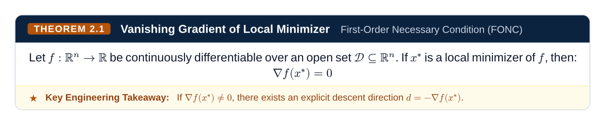
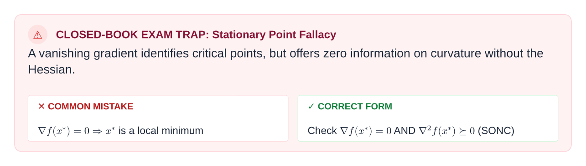
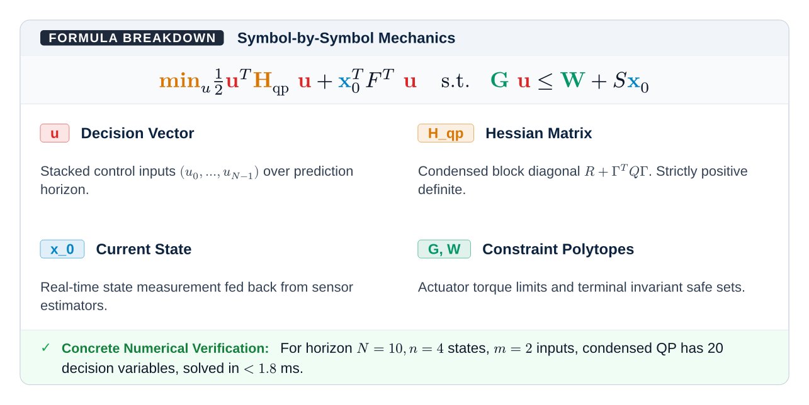
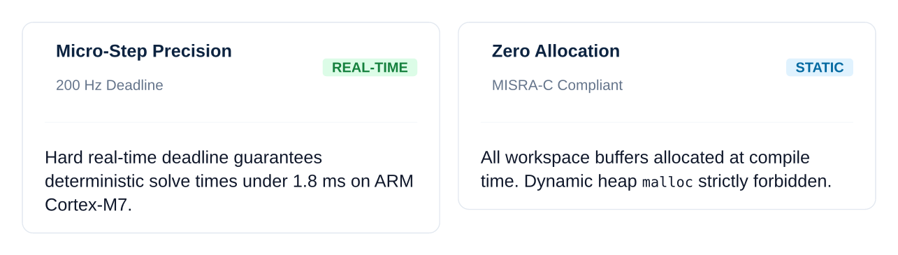
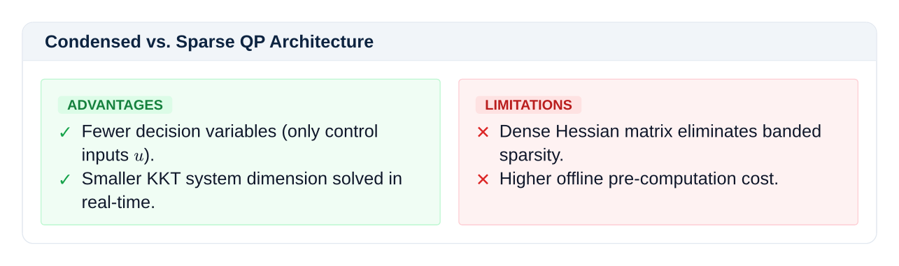
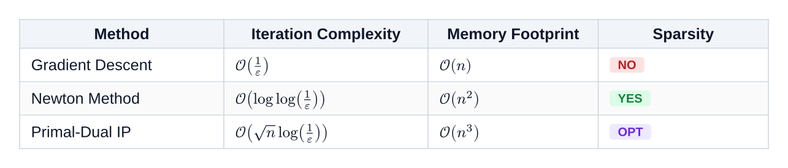
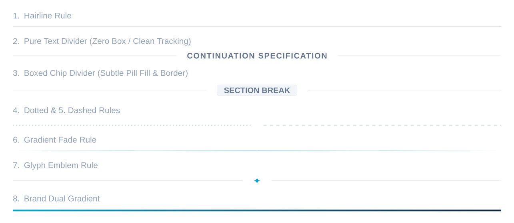

<p align="center">
  
</p>

# Floe ❄️

A tokenized design system, composable component library, and pedagogical layout toolkit for [Typst](https://typst.app).

Floe provides modular structural primitives (cards, plaques, badges, steppers, dividers), composable show rules (code blocks, anti-orphan headings, single-line running headers via Hydra), and academic callouts (theorems, definitions, exam traps, equation dissections) for course readers, lecture notes, technical reports, and presentations.

---

## Showcase

> [!TIP]
> **Complete Component & API Reference:** This showcase highlights a few selected components. Every primitive, mixin, component, and preset is documented in depth with live Typst code, parameter tables, and visual previews on the **[Documentation Site](https://spanishsyntax.github.io/Floe)**.

<table>
  <thead>
    <tr>
      <th width="20%">Component</th>
      <th width="80%">Visual Preview</th>
    </tr>
  </thead>
  <tbody>
    <tr>
      <td valign="middle">
        <a href="https://spanishsyntax.github.io/Floe/#/components?id=theorem-plaque"><code>#theorem(...)</code></a>
      </td>
      <td valign="middle" align="center">
        
      </td>
    </tr>
    <tr>
      <td valign="middle">
        <a href="https://spanishsyntax.github.io/Floe/#/components?id=closed-book-exam-trap"><code>#pitfall(...)</code></a>
      </td>
      <td valign="middle" align="center">
        
      </td>
    </tr>
    <tr>
      <td valign="middle">
        <a href="https://spanishsyntax.github.io/Floe/#/components?id=formula-breakdown-canvas"><code>#formula-breakdown(...)</code></a>
      </td>
      <td valign="middle" align="center">
        
      </td>
    </tr>
    <tr>
      <td valign="middle">
        <a href="https://spanishsyntax.github.io/Floe/#/components?id=bento-grid"><code>#bento-grid(...)</code></a>
      </td>
      <td valign="middle" align="center">
        
      </td>
    </tr>
    <tr>
      <td valign="middle">
        <a href="https://spanishsyntax.github.io/Floe/#/components?id=architectural-tradeoffs"><code>#pro-con(...)</code></a>
      </td>
      <td valign="middle" align="center">
        
      </td>
    </tr>
    <tr>
      <td valign="middle">
        <a href="https://spanishsyntax.github.io/Floe/#/components?id=adaptive-tables"><code>#data-table(...)</code></a>
      </td>
      <td valign="middle" align="center">
        
      </td>
    </tr>
    <tr>
      <td valign="middle">
        <a href="https://spanishsyntax.github.io/Floe/#/primitives?id=dividers"><code>#text-divider(...)</code><br><br><code>#chip-divider(...)</code></a>
      </td>
      <td valign="middle" align="center">
        
      </td>
    </tr>
  </tbody>
</table>

---

## Why "Floe"? (The Lore)

> **ice floe** (`/floʊ/`) — *noun:* A flat, buoyant sheet of sea ice drifting independently across open arctic waters, providing sure-footed footing and refuge without the immovable, submerged bulk of a glacier.

In document engineering and academic publishing, most templates behave like **icebergs**: massive, rigid monoliths where 90% of the complexity is submerged underwater. If you want to change a heading font or widen a table margin, you collide with hundreds of lines of brittle, interconnected macros that pull your layout down into the deep.

**Floe is designed as an archipelago of ice floes:**

- **Flat, Visible & Buoyant**: What you see is what you get. Every primitive is lightweight, self-contained, and floats on top of your document without hidden side effects.
- **Step Across Freely**: You don't have to adopt an entire opinionated universe. A polar bear doesn't need the entire arctic ice sheet to cross the ocean—it just needs a stable floe to step on. You can use a single `#card`, `#formula-breakdown`, or `#text-divider` floe in your document and leave everything else untouched.

---

## What is Floe?

**Is Floe a framework? A template? Or a component library?**

Floe is a **composable UI design system and component toolkit** for Typst—analogous to what **Tailwind CSS + Shadcn UI + Radix Primitives** are to modern web engineering:

- **Not a rigid, monolithic template**: Traditional LaTeX and Typst templates box you into a multi-hundred-line monolithic function where changing font sizes or margins breaks header alignment or requires rewriting the package internals.
- **Atomic & Decoupled**: Floe separates styling into five independent layers: tokens, layout atoms, show-rule mixins, pedagogical components, and optional document presets.
- **Zero Lock-In**: You can use Floe as a complete turnkey document engine with one-line presets (`#show: textbook.with(...)`), or you can completely ignore the presets and cherry-pick only the specific atoms (`#card`, `#theorem`, `#text-divider`, `#formula-breakdown`) you need in an existing custom Typst document.

---

## 100% Overridable & Extensible

**Every layer in Floe is designed to be predictably overridden without touching library sources:**

1. **Token Overrides**: All palette colors (`floe-navy`, `floe-cyan`, `floe-amber`), typography scales (`text-scale`), font families (`fonts.sans`, `fonts.serif`, `fonts.mono`), radii (`radii.sm`, `radii.md`), and stroke widths (`strokes.border`, `strokes.hairline`) are first-class variables.
2. **Component Parameter Overrides**: Every card, plaque, alert, divider, and table accepts explicit styling parameters (`accent`, `fill`, `stroke`, `radius`, `inset`, `color`). If you pass a custom accent or fill, the component seamlessly overrides its default theme.
3. **Composable Show-Rule Mixins**: Mixins are pure, independent show rules (`#show: with-code-theme`, `#show: with-heading-theme`, `#show: with-table-theme`). You can apply them selectively, reorder them, or chain them before or after your own custom `#show` rules.
4. **Custom Atomic Assemblies**: Because primitives like `#card` and `#plaque` make zero domain assumptions, you can assemble brand new domain components (e.g., custom medical case studies, legal briefs, hardware registers) in five lines of code.

---

## GitHub Flavored Markdown (GFM) Compatibility [WIP]

A primary design goal of Floe is **first-class, drop-in compatibility with GitHub Flavored Markdown (GFM)**:

> **The Vision:** Write ordinary `.md` technical notes, lecture transcripts, and READMEs, parse them with standard Typst markdown tools (like `cmarker`), apply Floe mixins, and compile publication-grade PDFs with zero manual syntax conversions.

### Current GFM Support
- **GFM Callouts**: `#show: with-gfm-theme` automatically transforms GitHub blockquotes (`> [!NOTE]`, `> [!TIP]`, `> [!IMPORTANT]`, `> [!WARNING]`, `> [!CAUTION]`) into delicate Shadcn callout cards with zero thick left-bars.
- **Fenced Code Blocks**: `#show: with-code-theme` transforms GitHub Markdown code fences (` ```rust ... ``` `) into macOS terminal windows with traffic-light dots, language badges, and syntax highlighting.
- **Tables**: `#show: with-table-theme` transforms standard Markdown tables into clean, proportional tables with hairline headers and alternating zebra stripes.

> [!NOTE]
> **Active Work-in-Progress (WIP):** Full GFM feature parity across extended table alignments, interactive task lists (`- [ ]` / `- [x]`), inline keycaps, footnotes, and equation pedestals is under continuous active development. We welcome community issues, test cases, and contributions!

---

## Installation

### Typst Universe

Import the package directly in any Typst document:

```typst
#import "@preview/floe:0.1.0": *
```

### Local Development

To use the local development build or contribute to Floe:

```bash
mkdir -p ~/.local/share/typst/packages/local/floe
ln -s /path/to/Floe ~/.local/share/typst/packages/local/floe/0.1.0
```

Then import the local package:

```typst
#import "@local/floe:0.1.0": *
```

---

## Quick Start

```typst
#import "@preview/floe:0.1.0": *

#show: textbook.with(
  title: "Optimal Control & Dynamic Programming",
  course-code: "SC42056",
  institution: "Systems & Control Institute • Academic Series",
)

#chapter-header(
  num: 1,
  title: "First-Order Optimality Conditions",
  subtitle: "Unconstrained minimization, stationary points, and descent directions",
)

== Necessary Conditions

#theorem(
  num: "1.1",
  title: "First-Order Necessary Condition (FONC)",
  takeaway: [If $nabla f(x^*) eq.not 0$, the negative gradient $d = -nabla f(x^*)$ is a strict descent direction.],
)[
  Let $f: bb(R)^n -> bb(R)$ be continuously differentiable over an open set $cal(D) subset.eq bb(R)^n$.
  If $x^* in cal(D)$ is a local minimizer of $f$, then:
  $ nabla f(x^*) = 0 $
]

#pitfall(
  title: "Vanishing Gradient Fallacy",
  mistake: [$nabla f(x^*) = 0 arrow.double x^*$ is a local minimum],
  correct: [Check $nabla f(x^*) = 0$ AND $nabla^2 f(x^*) succ.eq 0$ (SONC)],
)[
  $nabla f(x) = 0$ identifies stationary points, not minimizers. Saddle points and local maximizers also satisfy FONC.
]
```

---

## Document Presets (Turnkey Engines)

Five complete document engines configured with a single `#show` rule:

| Preset | Format | Purpose | Preview & Docs |
| :--- | :--- | :--- | :--- |
| `#show: textbook.with(...)` | A4 Single-Column | Course readers, textbook companions, and study guides with Hydra chrome. | [Example](examples/textbook_example.typ) • [Docs](https://spanishsyntax.github.io/Floe/#/presets?id=textbook-companion) |
| `#show: report.with(...)` | A4 Sans-Serif | Engineering reports, design reviews (PDR/CDR), and technical whitepapers. | [Example](examples/report_example.typ) • [Docs](https://spanishsyntax.github.io/Floe/#/presets?id=engineering-report) |
| `#show: slides.with(...)` | 16:9 Widescreen | Keynote-style presentation slides with dark and light themes. | [Example](examples/slides_example.typ) • [Docs](https://spanishsyntax.github.io/Floe/#/presets?id=presentation-slides) |
| `#show: cheatsheet.with(...)` | Landscape 3-Column | Dense closed-book exam revision and quick-reference formula sheets. | [Example](examples/cheatsheet_example.typ) • [Docs](https://spanishsyntax.github.io/Floe/#/presets?id=formula-cheatsheet) |
| `#show: memo.with(...)` | A4 Briefing | Executive decision memos with structured metadata plaques and executive summaries. | [Example](examples/memo_example.typ) • [Docs](https://spanishsyntax.github.io/Floe/#/presets?id=decision-memo) |

---

## Architecture

Floe is structured into five decoupled layers. You can use high-level presets (`textbook`, `report`, `slides`), cherry-pick individual components (`theorem`, `formula-breakdown`, `data-table`), or compose pure layout atoms (`card`, `plaque`, `stepper`) with zero external side effects.

```
Floe/
├── core/                      # Tokens, metrics, palettes & package bindings
├── primitives/                # Zero-domain layout geometry, cards, badges, steppers
├── mixins/                    # Pure show rules: headings, chrome, code, math, tables
├── components/                # Academic plaques, alerts, formula breakdown, layouts, tables
└── presets/                   # Master document templates: textbook, report, slides, memo
```

Every module exposes a `lib.typ` entrypoint, allowing either whole-library or layer-specific imports:

```typst
#import "@preview/floe:0.1.0": *                // Import everything
#import "@preview/floe:0.1.0/primitives": *     // Import only primitives
#import "@preview/floe:0.1.0/mixins": *         // Import only show rules
#import "@preview/floe:0.1.0/components": *     // Import only components
#import "@preview/floe:0.1.0/presets": *        // Import only document presets
```

---

## Component Reference

### 1. Atomic Primitives (`primitives/`)

| Primitive | Parameters | Description |
| :--- | :--- | :--- |
| `#card(...)` | `title`, `badge-label`, `border-color`, `body` | Base content card with header, badge chip, and subtle hairline border. |
| `#plaque(...)` | `tag`, `num`, `title`, `accent`, `title-below`, `body` | Chamfered academic plaque container used by theorems and definitions. |
| `#stepper(...)` | `steps: ((num, title, body), ...)` | Ordered algorithmic or derivation stepper with connected counter circles. |
| `#item-card(...)` | `title`, `desc`, `tag`, `tag-color` | Compact parameter / variable breakdown card. |
| `#item-grid(...)` | `items`, `columns: (1fr, 1fr)` | Multi-column grid enforcing uniform height across all items in a row. |
| `#badge(...)` | `label`, `variant: "info" \| "success" \| "warning" \| "danger"` | Semantic status pill tag with automatic baseline alignment. |
| `#kbd(...)` | `key` | Rendered keyboard keycap (e.g. `#kbd("Ctrl") + #kbd("C")`). |
| `#divider(...)` | `color`, `thickness` | Subtle horizontal hairline separator rule. |
| `#text-divider(...)` | `label`, `text-color`, `color` | Pure uppercase text label centered between hairline rules (zero box). |
| `#chip-divider(...)` | `label`, `badge-fill`, `color` | Boxed pill chip badge centered between hairline rules. |
| `#labeled-divider(...)` | `label`, `boxed: false`, `color` | Unified labeled divider (clean text by default, or boxed chip). |
| `#dotted-divider(...)` | `color`, `thickness` | Dotted separator rule. |
| `#dashed-divider(...)` | `color`, `thickness` | Dashed separator rule. |
| `#fade-divider(...)` | `color`, `thickness` | Gradient fade divider tapering smoothly at page margins. |
| `#icon-divider(...)` | `icon`, `icon-color`, `color` | Glyph emblem separator rule (e.g. `✦`). |
| `#gradient-divider(...)` | `from-color`, `to-color` | Brand linear gradient accent divider. |

### 2. Composable Mixins (`mixins/`)

Mixins are pure `#show` rules that configure document behavior without modifying raw Markdown or Typst content:

```typst
#show: with-heading-theme.with(numbering: "1.1") // Anti-orphan titles, clean chapter counters
#show: with-running-chrome.with(...)             // Single-line Hydra headers & page footers
#show: with-code-theme                           // Shaded terminal blocks with language badges
#show: with-math-theme                           // Bracketed matrix delimiters and equation spacing
#show: with-table-theme                          // Hairline striped table styling
#show: with-gfm-theme                            // Maps GitHub blockquotes (> [!NOTE]) to cards
#show: with-compact-theme                        // Tight margins for dense formula cheatsheets
```

### 3. Academic Callouts (`components/academic.typ`)

- `#theorem(num: "", title: "", takeaway: none)[...]` — David C. Lay-style theorem block with gold accent bar and optional key engineering takeaway banner.
- `#definition(num: "", term: "", tag: none)[...]` — Formal academic definition with sky-blue tint and title placement optimized for long phrases.
- `#lemma(num: "", title: "")[...]` — Supporting mathematical lemma with lavender accent.
- `#corollary(title: "")[...]` — Direct logical consequence environment.
- `#algorithm(num: "", title: "")[...]` — Algorithmic procedure card.
- `#proof-sketch(title: none)[...]` — Left-ruled derivation with trailing open QED marker (`□`).

### 4. Exam Traps & Alerts (`components/alerts.typ`)

- `#pitfall(title: "", mistake: none, correct: none)[...]` — Closed-book exam trap card with side-by-side Common Mistake vs. Correct Form chips measured to equal height.
- `#exam-alert(title: "")[...]` — Amber key formula reminder for closed-book examinations.
- `#note(title: "")[...]` — Sky-blue informational remark.
- `#tip(title: "")[...]` — Emerald green engineering best practice.
- `#warning(title: "")[...]` — Amber saturation / stability boundary alert.

### 5. Canva Visual Dissection (`components/pedagogical.typ`)

- `#formula-breakdown(formula: $...$, symbols: (...), arithmetic: [...])` — Places an equation on a prominent pedestal, renders symbol breakdown cards in equal-height rows, and includes a numerical sanity-check strip.
- `#physical-anchor(title: "", system: "")[...]` — Grounds abstract matrix algebra in physical engineering hardware (e.g. satellites, quadruped robotics, quadrotors).
- `#worked-example(title: "", problem: [...], solution: [...])[...]` — Step-by-step problem statement, derivation, and verified final result card.

### 6. Adaptive Layouts & Tables (`components/layouts.typ`, `components/tables.typ`)

- `#split-view(left, right, titles: (...), badges: (...))` — Two-column comparison layout with dynamic context measurement guaranteeing identical panel heights.
- `#pro-con(pros: (...), cons: (...), title: "...")` — Advantages vs. limitations comparison card with equal-height columns.
- `#bento-grid(columns: (1fr, 1fr), ..cells)` — Modern asymmetric feature showcase grid.
- `#key-value-grid(items: (...))` — Zebra-striped parameter specification table.
- `#data-table(columns: (...), headers: (...), ..cells)` — Safe table wrapper with automatic fractional column expansion and `table.header` repetition across page breaks.
- `#spec-table(..pairs)` — 2-column parameter / specification key-value table.

### 7. Document Presets (`presets/`)

- `#show: textbook.with(...)` — Single-column publication-grade textbook companion with running headers, chapter counters, and clean table of contents.
- `#show: report.with(...)` — Clean sans-serif engineering report and technical memorandum.
- `#show: slides.with(...)` — 16:9 widescreen presentation slide deck (supports light and dark themes).
- `#show: cheatsheet.with(...)` — 2- or 3-column dense landscape formula reference sheet.
- `#show: memo.with(...)` — Executive decision memo with header metadata plaque.

---

## Gallery & Visual Showcase

A comprehensive visual test suite showcasing every primitive, mixin, and component in action is located in [`examples/gallery.typ`](examples/gallery.typ).

To compile the gallery locally:

```bash
typst compile --root . examples/gallery.typ examples/gallery.pdf
```

---

## License

MIT License © SpanishSyntax. Part of the [Frost / Icebergs](https://github.com/SpanishSyntax) ecosystem.
