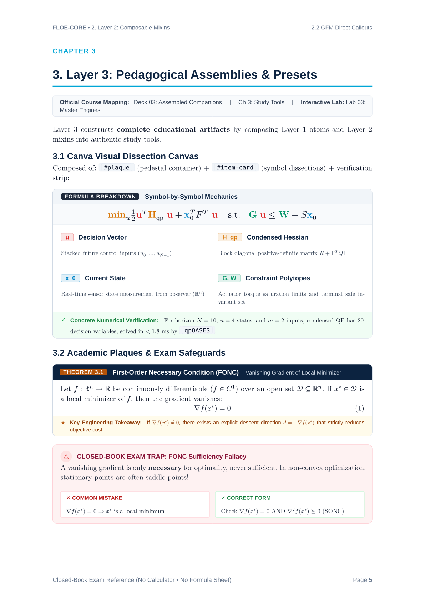

  

# Floe

[Overview](README.md) • [Getting Started](getting-started.md) • [Core](core.md) • [Primitives](primitives.md) • [Mixins](mixins.md) • [Components](components.md) • [Presets](presets.md)

---

> The Composable UI Design System and Component Library for [Typst](https://typst.app).

Floe brings the modularity, atomic design hierarchy, and thoughtful aesthetics of modern web design systems to technical documents: course readers, lecture notes, textbook companions, engineering reports, architecture decision records, and presentation slides.

  

---

## Why Floe

> **ice floe** (`/floʊ/`) — *noun:* A flat, buoyant sheet of sea ice drifting independently across open arctic waters, providing sure-footed footing and refuge without the immovable, submerged bulk of a glacier.

In document engineering and academic publishing, most templates behave like **icebergs**: massive, rigid monoliths where 90% of the complexity is submerged underwater. If you want to change a heading font or widen a table margin, you collide with hundreds of lines of brittle, interconnected macros that pull your layout down into the deep.

**Floe is designed as an archipelago of ice floes:**

- **Flat, Visible, and Buoyant**: What you see is what you get. Every primitive is lightweight, self-contained, and floats on top of your document without hidden side effects.
- **Step Across Freely**: You do not have to adopt an entire opinionated universe. A polar bear does not need the entire arctic ice sheet to cross the ocean—it just needs a stable floe to step on. You can drop a single `#card`, `#formula-breakdown`, `#sci-plot`, or `#text-divider` floe into your document and leave everything else untouched.

---

## Architecture

Floe decouples styling into five distinct layers:

1. **Layer 0 — Core Foundation**: Design tokens (`floe-cyan`, `slate-50` through `slate-950`, semantic equation roles, typography scales, strokes, radii), unified third-party engine bindings (`CeTZ`, `Hydra`, `Fletcher`, `Merman`, `Physica`, `Unify`, `Zap`, `Lovelace`), and the pure-Typst chemical formula parser (`#ce`).
2. **Layer 1 — Atomic Primitives**: Zero-domain layout geometry (`equal-row`, `card`, `alert-box`, `plaque`, `figure-box`, `item-card`, `stepper`, `badge`, `kbd`, `text-divider`) that handle borders, paddings, and alignment without imposing content assumptions.
3. **Layer 2 — Composable Mixins**: Pure `#show` rules that transform running headers, section headings, matrices, syntax-highlighted code blocks, native `mermaid` diagrams, tables, and GitHub-Flavored Markdown callouts without breaking raw Markdown or Typst content.
4. **Layer 3 — High-Level Components**: Domain-specific pedagogical and engineering components built on Layer 1 atoms (`theorem`, `definition`, `pitfall`, `formula-breakdown`, `matrix-anatomy`, `sci-plot`, `chem-scheme`, `bento-grid`, `split-view`, `data-table`, `chapter-header`, `slide-hero`).
5. **Layer 4 — Document Presets**: Ready-to-use master document templates (`textbook`, `report`, `slides`, `cheatsheet`, `memo`, `adr`).

You can adopt a complete Layer 4 preset or cherry-pick individual components and primitives into any existing document without unwanted side effects.

---

## Documentation Navigation

- [Getting Started](getting-started.md) — Installation, quick start example, and layered import guide
- [Layer 0: Core Foundation](core.md) — Design tokens, typography scales, backend packages, and `#ce` chemical parser
- [Layer 1: Atomic Primitives](primitives.md) — Equal-height rows, cards, plaques, figures, item grids, steppers, badges, and dividers
- [Layer 2: Composable Mixins](mixins.md) — Running chrome, heading counters, math rules, code themes, Mermaid rendering, and GFM callouts
- [Layer 3: High-Level Components](components.md) — Academic callouts, exam traps, formula breakdowns, scientific plotting, layouts, and rounded tables
- [Layer 4: Document Presets](presets.md) — Textbook companion, engineering report, 16:9 presentation slides, cheatsheet, decision memo, and ADR
