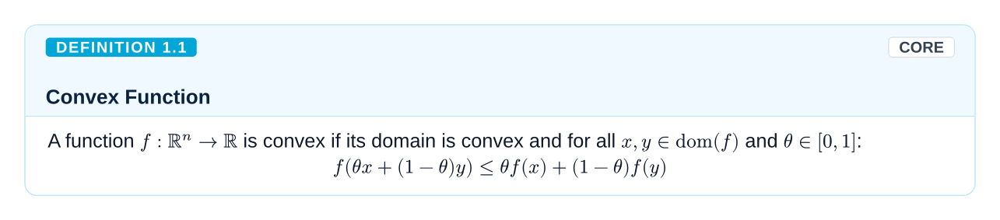
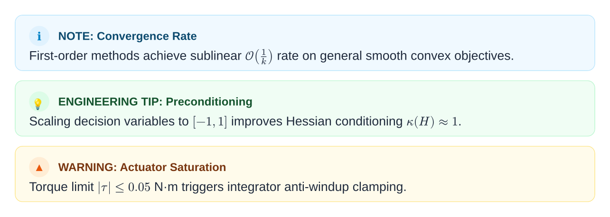
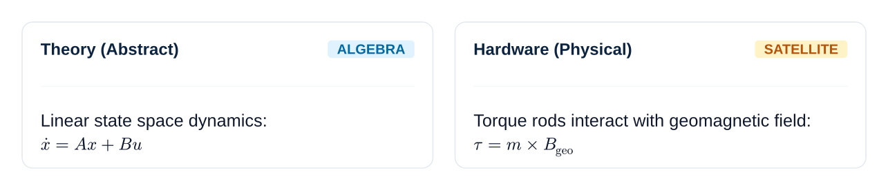
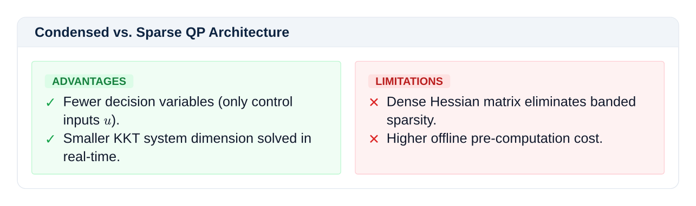
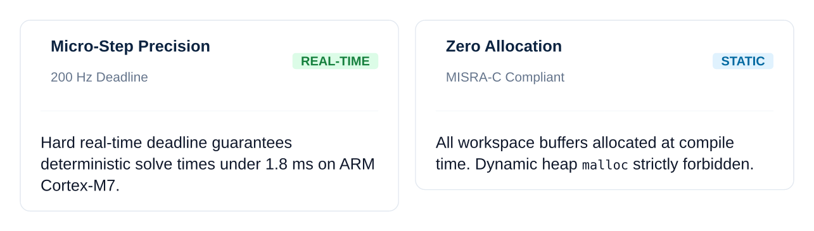
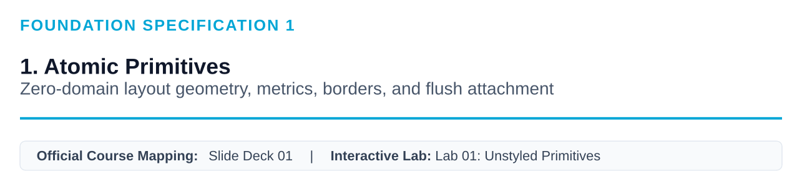

# Layer 3: High-Level Components

[Overview](README.md) • [Getting Started](getting-started.md) • [Core](core.md) • [Primitives](primitives.md) • [Mixins](mixins.md) • [Components](components.md) • [Presets](presets.md)

---

Components are domain-rich pedagogical and academic tools constructed by composing Layer 1 primitives and Layer 0 tokens.

---

## Academic Plaques

### Theorem Plaque

David C. Lay-style theorem block with an amber accent strip and key engineering takeaway banner:

```typst
#theorem(
  num: "2.1",
  title: "First-Order Necessary Condition (FONC)",
  name: "Vanishing Gradient of Local Minimizer",
  takeaway: [If $nabla f(x^*) eq.not 0$, there exists an explicit descent direction $d = -nabla f(x^*)$.],
)[
  Let $f: bb(R)^n -> bb(R)$ be continuously differentiable over an open set $cal(D) subset.eq bb(R)^n$.
  If $x^*$ is a local minimizer of $f$, then:
  $ nabla f(x^*) = 0 $
]
```


### Definition Plaque

Formal definition card with a sky-blue accent:

```typst
#definition(
  num: "1.1",
  term: "Convex Function",
  tag: "CORE",
)[
  A function $f: bb(R)^n -> bb(R)$ is convex if its domain is convex and for all $x, y in "dom"(f)$ and $theta in [0, 1]$:
  $ f(theta x + (1 - theta)y) <= theta f(x) + (1 - theta)f(y) $
]
```



---

## Exam Traps & Alerts

### Closed-Book Exam Trap

Closed-book exam trap card with side-by-side **Common Mistake** vs. **Correct Form** chips measured to identical height:

```typst
#pitfall(
  title: "Stationary Point Fallacy",
  mistake: [$nabla f(x^*) = 0 arrow.double x^*$ is a local minimum],
  correct: [Check $nabla f(x^*) = 0$ AND $nabla^2 f(x^*) succ.eq 0$ (SONC)],
)[
  A vanishing gradient identifies critical points, but offers zero information on curvature without the Hessian.
]
```


### Alert Badges

Informational notes, engineering recommendations, and boundary saturation notices:

```typst
#note(title: "Convergence Rate")[First-order methods achieve sublinear $cal(O)(1/k)$ rate on general smooth convex objectives.]
#tip(title: "Preconditioning")[Scaling decision variables to $[-1, 1]$ improves Hessian conditioning $kappa(H) approx 1$.]
#warning(title: "Actuator Saturation")[Torque limit $|tau| <= 0.05$ N·m triggers integrator anti-windup clamping.]
```



---

## Formula Breakdown Canvas

Displays a complex equation on a prominent central pedestal, followed by symbol breakdown cards arranged in equal-height rows, and a concrete numerical sanity-check banner:

```typst
#formula-breakdown(
  formula: $#math-cost[min]_u 1/2 #math-input[u]^T #math-cost[H]_text("qp") #math-input[u] + #math-state[x]_0^T F^T #math-input[u] quad "s.t." quad #math-sensor[G] #math-input[u] <= #math-sensor[W] + S #math-state[x]_0$,
  card-columns: (1fr, 1fr),
  symbols: (
    (c-input, "u", "Decision Vector", [Stacked control inputs $(u_0, dots, u_(N-1))$ over prediction horizon.]),
    (c-cost, "H_qp", "Hessian Matrix", [Condensed block diagonal $R + Gamma^T Q Gamma$. Strictly positive definite.]),
    (c-state, "x_0", "Current State", [Real-time state measurement fed back from sensor estimators.]),
    (c-sensor, "G, W", "Constraint Polytopes", [Actuator torque limits and terminal invariant safe sets.]),
  ),
  arithmetic: [For horizon $N = 10, n = 4$ states, $m = 2$ inputs, condensed QP has 20 decision variables, solved in $< 1.8$ ms.],
)
```


---

## Adaptive Layouts & Bento

### Split-View Comparison

Two-column comparison view with dynamic context measurement guaranteeing identical panel heights:

```typst
#split-view(
  titles: ("Theory (Abstract)", "Hardware (Physical)"),
  badges: ("ALGEBRA", "SATELLITE"),
  [Linear state space dynamics: \ $dot(x) = A x + B u$],
  [Torque rods interact with geomagnetic field: \ $tau = m times B_"geo"$],
)
```



### Architectural Tradeoffs

Side-by-side advantages vs. limitations comparison card:

```typst
#pro-con(
  title: "Condensed vs. Sparse QP Architecture",
  pros: (
    "Fewer decision variables (only control inputs $u$).",
    "Smaller KKT system dimension solved in real-time.",
  ),
  cons: (
    "Dense Hessian matrix eliminates banded sparsity.",
    "Higher offline pre-computation cost.",
  ),
)
```



### Bento Grid

Modern asymmetric showcase grid:

```typst
#bento-grid(
  columns: (1fr, 1fr),
  bento-cell(title: "Micro-Step Precision", subtitle: "200 Hz Deadline", badge-label: "REAL-TIME", badge-variant: "success")[
    Hard real-time deadline guarantees deterministic solve times under 1.8 ms on ARM Cortex-M7.
  ],
  bento-cell(title: "Zero Allocation", subtitle: "MISRA-C Compliant", badge-label: "STATIC", badge-variant: "info")[
    All workspace buffers allocated at compile time. Dynamic heap `malloc` strictly forbidden.
  ],
)
```



---

## Adaptive Tables

Safe table wrapper with automatic fractional column expansion and `table.header` repetition across page breaks:

```typst
#data-table(
  headers: ("Method", "Iteration Complexity", "Memory Footprint", "Sparsity"),
  columns: (1.2fr, 1.2fr, 1fr, 1fr),
  "Gradient Descent", $cal(O)(1/epsilon)$, $cal(O)(n)$, badge-no,
  "Newton Method", $cal(O)(log log(1/epsilon))$, $cal(O)(n^2)$, badge-yes,
  "Primal-Dual IP", $cal(O)(sqrt(n) log(1/epsilon))$, $cal(O)(n^3)$, badge-opt,
)
```


---

## Hero & Section Headers

Demarcates chapter starts, executes page breaks, synchronizes section counters, and renders the hero presentation card:

```typst
#chapter-header(
  num: 1,
  title: "Atomic Primitives",
  subtitle: "Zero-domain layout geometry, metrics, borders, and flush attachment",
  eyebrow: "FOUNDATION SPECIFICATION",
  slides-ref: "Slide Deck 01",
  teardown-ref: "Lab 01: Unstyled Primitives",
)
```


