# Layer 3: High-Level Components

[Overview](README.md) • [Getting Started](getting-started.md) • [Core](core.md) • [Primitives](primitives.md) • [Mixins](mixins.md) • [Components](components.md) • [Presets](presets.md)

---

Components are domain-rich pedagogical, scientific, and editorial building blocks constructed by composing Layer 1 primitives (`#plaque`, `#alert`, `#card`, `#equal-grid`, `#badge`) and Layer 0 design tokens. Every component has a single canonical name with zero duplicate aliases.

---

## Academic Callouts

**Source Module:** `components/academic.typ`

Academic callouts wrap the `#plaque` primitive with semantic color accents, structured numbering (`num`), and optional takeaway banners.

### Theorem

`#theorem` renders a formal theorem plaque with a navy header, amber accent strip, and optional `takeaway` engineering summary banner at the bottom:

```typst
#theorem(
  num: "4.1",
  title: "Lyapunov Global Asymptotic Stability Criterion",
  takeaway: [A radially unbounded energy function $V(x) > 0$ with strictly negative orbital derivative $dot(V)(x) < 0$ guarantees global asymptotic stability.],
)[
  Let $x = 0$ be an equilibrium of $dot(x) = f(x)$ on $RR^n$. If there exists a radially unbounded function $V in C^1(RR^n, RR)$ such that $V(0) = 0$, $V(x) > 0$ for all $x != 0$, and $grad V(x)^top f(x) < 0$ for all $x != 0$, then $x = 0$ is globally asymptotically stable.
]
```

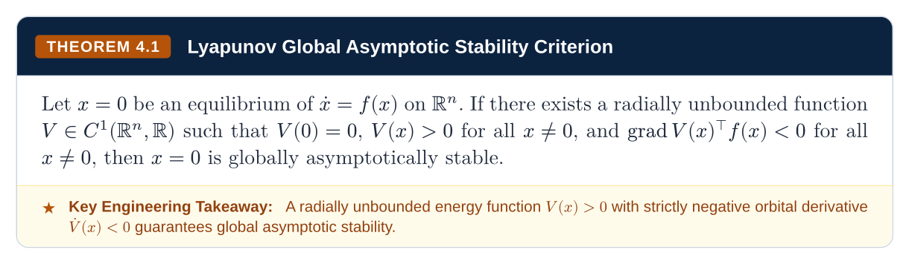

### Definition

`#definition` renders a formal definition card with a sky-blue (`floe-cyan`) accent and an optional domain `tag` pill badge:

```typst
#definition(
  num: "4.1",
  title: "Radially Unbounded Storage Function",
  tag: "NONLINEAR SYSTEMS",
)[
  A scalar function $V: RR^n -> RR$ is *radially unbounded* (coercive) if $lim_(norm(x) -> oo) V(x) = +oo$, ensuring that every sublevel set $Omega_c = {x in RR^n : V(x) <= c}$ is compact.
]
```


### Lemma and Corollary

`#lemma` (purple accent) and `#corollary` (slate accent) present supporting mathematical results and immediate deductive consequences. When placed side-by-side inside `#equal-grid`, they stretch to identical row height automatically:

```typst
#equal-grid(
  columns: (1fr, 1fr),
  gutter: 8pt,
  lemma(num: "4.1", title: "Schur Complement Positive-Definiteness")[
    For symmetric $M = mat(A, B; B^top, C)$ with $C succ 0$, $M succ 0$ if and only if $A - B C^(-1) B^top succ 0$.
  ],
  corollary(title: "Linear Matrix Inequality Convexity")[
    Quadratic matrix inequalities in $P$ reduce to linear affine inequalities via the Schur complement.
  ],
)
```

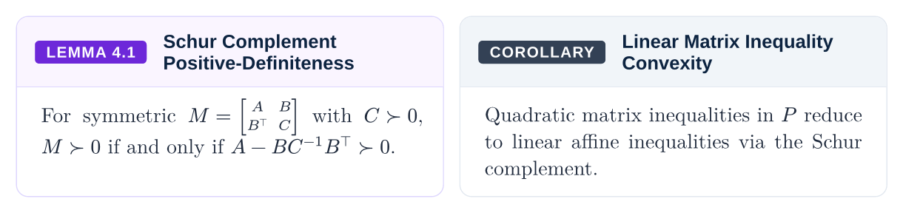

### Algorithm

`#algorithm` formats structured pseudocode and numerical optimization routines inside a dark-slate academic plaque:

```typst
#algorithm(num: "4.1", title: "Primal-Dual Interior-Point Newton Step")[
  1. *Input:* Strictly feasible iterate $(x_k, lambda_k, s_k)$ with $x_k, s_k > 0$ and barrier parameter $mu_k = (x_k^top s_k) / n$.
  2. *Solve Newton KKT System:* Compute affine-scaling and centering search direction $(Delta x, Delta lambda, Delta s)$.
  3. *Line Search:* Choose maximum step length $alpha_k in (0, 1]$ preserving $x_(k+1) > 0$ and $s_(k+1) > 0$.
]
```

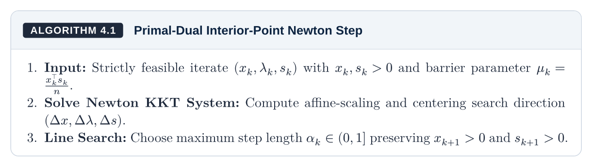

### Proof and Proof Sketch

`#proof` provides the single canonical mathematical proof environment with a left border rule and right-aligned Halmos tombstone (`□`). Pass `sketch: false` (the default) for a full rigorous proof or `sketch: true` for a concise proof sketch—no separate alias function is needed:

```typst
#proof(title: "Full Rigorous Proof (sketch: false, default)")[
  Along any trajectory $x(t)$ of $dot(x) = f(x)$, the chain rule yields $dv(V(x(t)), t) = grad V(x)^top f(x) < 0$ for all $x != 0$. Because $V(x)$ is bounded below by $0$ and strictly decreasing, $V(x(t)) -> 0$ as $t -> oo$.
]

#proof(sketch: true, title: "Compact Sublevel Set Invariance (sketch: true)")[
  Radial unboundedness guarantees $Omega_(V(x(0)))$ is compact and positively invariant, ruling out finite escape time.
]
```

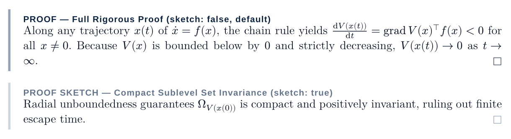

---

## Exam Traps and Alerts

**Source Module:** `components/alerts.typ`

High-visibility callouts built on top of the `#alert` primitive to highlight closed-book exam pitfalls, formula memorization requirements, and engineering boundaries.

### Closed-Book Exam Pitfall

`#pitfall` renders a danger callout with side-by-side **Common Mistake** (`✕`) and **Correct Form** (`✓`) comparison chips measured in `context` to guarantee equal chip heights:

```typst
#pitfall(
  title: "Confusing Necessary Stationary Points with Sufficient Minima",
  mistake: [
    Claiming $grad f(x^*) = 0 ==> x^*$ is a local minimum without checking the Hessian $nabla^2 f(x^*)$.
  ],
  correct: [
    Verify $grad f(x^*) = 0$ AND $nabla^2 f(x^*) succ 0 ==> x^*$ is a strict isolated local minimum.
  ],
)[
  On closed-book exams, always verify second-order sufficiency ($nabla^2 f(x^*) succ 0$ or convexity of $f$) after solving $grad f(x^*) = 0$.
]
```

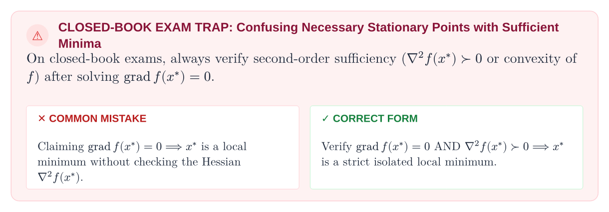

### Semantic Callouts

`#exam-alert`, `#note`, `#tip`, and `#warning` provide semantic callouts with circular icon badges for closed-book formula reminders, theoretical notes, computational shortcuts, and physical saturation warnings:

```typst
#equal-grid(
  columns: (1fr, 1fr),
  gutter: 8pt,
  exam-alert(title: "Memorize the 2x2 Inverse & Characteristic Polynomial")[
    For $A = mat(a, b; c, d)$, $det(s I - A) = s^2 - tr(A) s + det(A)$.
  ],
  note(title: "Hilbert Space Adjoint Convention")[
    In complex Hilbert spaces $CC^n$, the inner product uses the conjugate transpose $x^dagger y$.
  ],
  tip(title: "Exploit Triangular Structure")[
    Solve $(s I - A)^(-1) B$ by forward/backward substitution whenever $A$ is triangular.
  ],
  warning(title: "Actuator Windup Under Integral Action")[
    Unclamped integrators accumulate windup error when control inputs saturate at $plus.minus u_("max")$.
  ],
)
```


---

## Pedagogical Explainers

**Source Module:** `components/pedagogical.typ`

Visual dissection canvases and step-by-step notebooks that bridge abstract mathematical notation, physical intuition, and hand-worked numerical verification.

### Formula Breakdown

`#formula-breakdown` elevates a governing equation onto a central pedestal (color-coded with `#t1`..`#t6` or `#math-hl`), decomposes every symbol into equal-height color-coded cards (`symbols`, accepting either 3-tuples `($sym$, "Name", [Desc])` that auto-assign `term-palette` colors in order or 4-tuples `(color, $sym$, "Name", [Desc])`), and concludes with a concrete numerical sanity check (`arithmetic`):

```typst
#formula-breakdown(
  title: "Discrete-Time Kalman Filter Innovation & Posterior Update",
  formula: $#t1($hat(x)_(k|k)$) = hat(x)_(k|k-1) + #t2($K_k$) (#t3($y_k - C hat(x)_(k|k-1)$)), quad #t2($K_k$) = P_(k|k-1) C^top (C P_(k|k-1) C^top + #t4($R$))^(-1)$,
  symbols: (
    ($hat(x)_(k|k)$, "Posterior State Estimate", [Minimum-variance unbiased estimate in $RR^n$]),
    ($K_k$, "Optimal Kalman Gain", [Weights prior uncertainty $P_(k|k-1)$ against sensor noise $R$]),
    ($y_k - C hat(x)_(k|k-1)$, "Innovation Residual", [White zero-mean prediction error in $RR^p$]),
    ($R succ 0$, "Sensor Noise Covariance", [Measurement noise covariance $EE[v_k v_k^top] in RR^(p times p)$]),
  ),
  arithmetic: [
    In the scalar case ($C = 1, P_(k|k-1) = 4, R = 1$), the Kalman gain is $K_k = 4 / (4 + 1) = 0.8$, weighting the sensor measurement at $80%$.
  ],
)
```

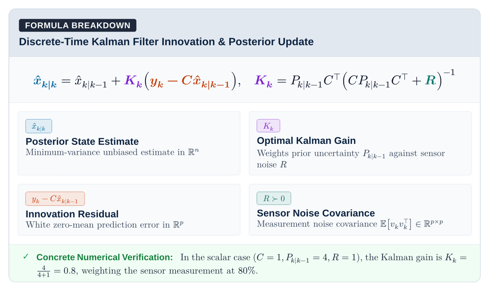

### Derivation Stepper

`#derivation-stepper` walks readers through a multi-step mathematical derivation, pairing each numbered algebraic transformation with a centered equation box and physical intuition note:

```typst
#derivation-stepper(
  title: "Completing the Square for the Linear-Quadratic Optimal Control Law",
  steps: (
    (
      "Expand the Hamiltonian Quadratic Form",
      $dot(V)(x) + x^top Q x + u^top R u = x^top (A^top P + P A + Q) x + 2 x^top P B u + u^top R u$,
      "Group all terms quadratic and linear in the control input u.",
    ),
    (
      "Complete the Square in the Control Input u",
      $2 x^top P B u + u^top R u = (u + R^(-1) B^top P x)^top R (u + R^(-1) B^top P x) - x^top P B R^(-1) B^top P x$,
      "Since R > 0 is symmetric positive-definite, the squared norm is minimized when it vanishes.",
    ),
    (
      "Extract Optimal Feedback Gain K* and Algebraic Riccati Equation",
      $u^*(t) = -R^(-1) B^top P x(t), quad A^top P + P A - P B R^(-1) B^top P + Q = 0$,
      "Setting the square to zero yields the optimal state-feedback law and the CARE.",
    ),
  ),
)
```

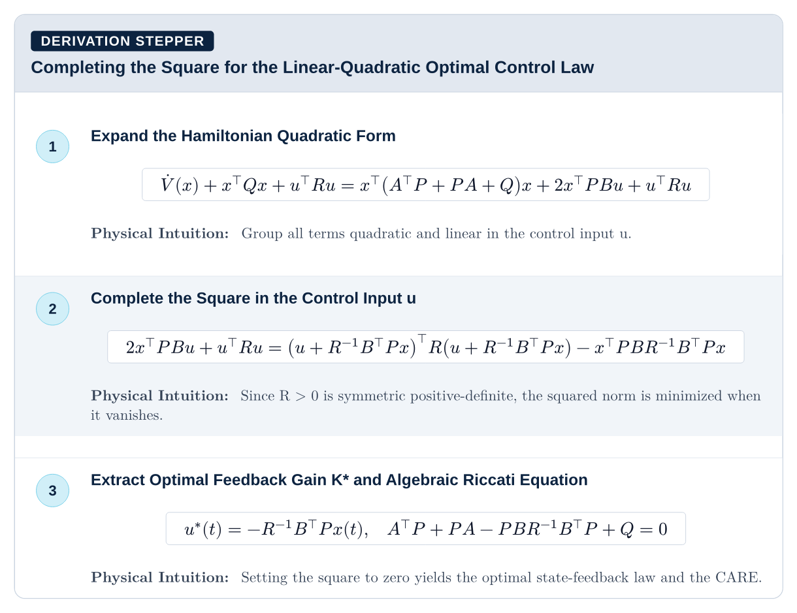

### Physical Anchor

`#physical-anchor` grounds abstract equations in concrete physical, chemical, or thermodynamic mechanics, tagging both the scientific `domain` and real-world `system`:

```typst
#physical-anchor(
  title: "Free Energy Minimization as an Energy-Entropy Tradeoff",
  domain: "THERMODYNAMICS & STATISTICAL MECHANICS",
  system: "Boltzmann Canonical Ensemble",
)[
  Minimizing the Helmholtz free energy $F = U - T S$ at constant temperature $T$ is physically identical to regularized optimization: at low temperature ($T -> 0$), the system locks into the minimum internal energy ground state $U$, whereas at high temperature ($T -> oo$), entropic exploration $-T S$ dominates.
]
```

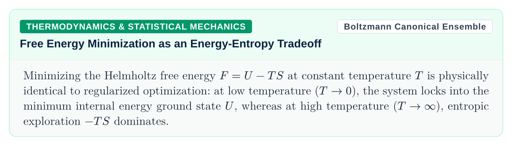

### Worked Numerical Example

`#worked-example` presents a self-contained hand-worked calculation with a dedicated `problem` statement block, numbered analytical steps, and a highlighted green `solution` banner:

```typst
#worked-example(
  title: "Checking Positive-Definiteness and Minimizer of a Bivariate Quadratic",
  problem: [
    Determine whether $f(x_1, x_2) = 2 x_1^2 - 2 x_1 x_2 + x_2^2 - 4 x_1 + 2 x_2 + 5$ has a unique global minimum, and compute $x^*$ and $f(x^*)$.
  ],
  solution: [
    $x^* = vec(1, 0)$ with global minimum value $f(1, 0) = 3$.
  ],
)[
  1. *Extract Hessian $H$ and Linear Vector $c$:* Writing $f(x) = 1/2 x^top H x + c^top x + 5$ gives $H = mat(4, -2; -2, 2)$ and $c = vec(-4, 2)$.
  2. *Sylvester's Criterion:* Leading principal minors are $Delta_1 = 4 > 0$ and $Delta_2 = det(H) = 8 - 4 = 4 > 0$, so $H succ 0$.
  3. *Stationarity $H x^* = -c$:* Solving $mat(4, -2; -2, 2) vec(x_1^*, x_2^*) = vec(4, -2)$ yields $x_1^* = 1, x_2^* = 0$.
]
```

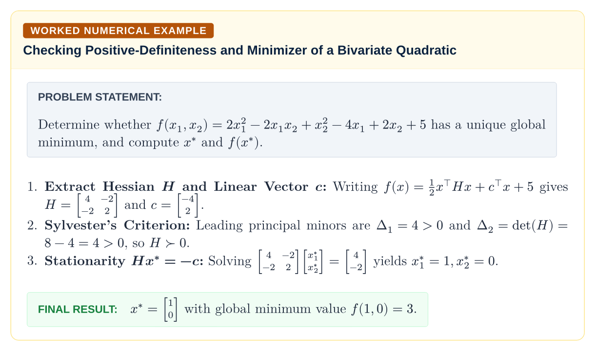

---

## Scientific Plotting and Chemistry

**Source Module:** `components/science.typ`

Native vector plotting and stoichiometric chemical reaction blocks powered by CeTZ and Floe's built-in chemistry parser.

### Native 2D Plotter

`#plot-2d` compiles continuous analytic functions (`functions`) and discrete sampled data series (`series`) directly into a CeTZ vector canvas with automatic range scaling, dashed gridlines, tick marks, axis titles, and a multi-column legend:

```typst
#plot-2d(
  title: "Underdamped Second-Order Step Response",
  subtitle: "Simultaneous analytic function evaluation and discrete scatter data series",
  badge-label: "components/science.typ",
  x-label: "Time t (s)",
  y-label: "Amplitude y(t)",
  x-domain: (0, 8),
  y-domain: (-0.8, 1.1),
  width: 11.2cm,
  height: 4.4cm,
  functions: (
    (fn: t => calc.exp(-0.4 * t) * calc.cos(2.8 * t), label: [Underdamped $e^(-0.4 t) cos(2.8 t)$], color: floe-cyan),
    (fn: t => calc.exp(-0.4 * t), label: [Envelope $plus.minus e^(-0.4 t)$], color: floe-red, dashed: true),
    (fn: t => -calc.exp(-0.4 * t), label: none, color: floe-red, dashed: true),
  ),
  series: (
    (
      points: ((0, 1.0), (1.1, -0.64), (2.2, 0.41), (3.3, -0.26), (4.4, 0.17), (5.5, -0.11), (6.6, 0.07)),
      label: [Sampled Data $y[k]$],
      color: floe-amber,
      only-marks: true,
    ),
  ),
  footer: [Figure 4.1: Rendered natively in Typst via `#plot-2d` with auto-ticks, gridlines, and legend.],
)
```

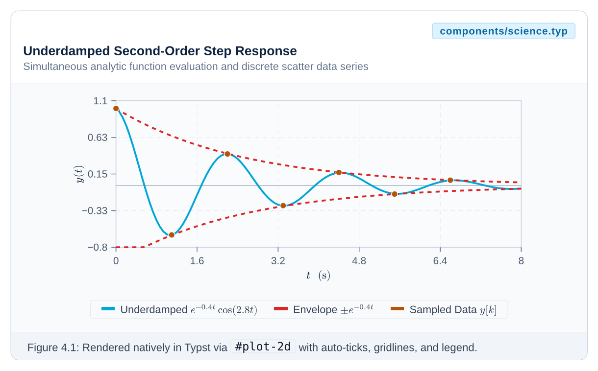

### Chemical Reaction Block

`#reaction` formats stoichiometric equations via `#ce(...)` alongside catalytic `condition` badges and thermodynamic state quantities (`delta-h`, `delta-g`, `k-eq`):

```typst
#reaction(
  "2SO2(g) + O2(g) <=> 2SO3(g)",
  title: "Contact Process Sulfur Trioxide Oxidation",
  condition: "V2O5 Catalyst • 450 °C • 2 atm",
  delta-h: "-197.8 kJ mol^-1",
  delta-g: "-141.6 kJ mol^-1",
  k-eq: "1.7 x 10^2",
  num: "4.1",
)
```

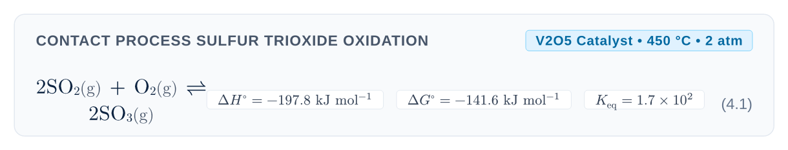

---

## Composite Layouts

**Source Module:** `components/layouts.typ`

Multi-column comparative containers and bento showcases. All multi-column layouts delegate row geometry to `#equal-grid`, guaranteeing equalized panel heights across every row.

### Split-View Comparison

`#split-view` places two conceptual domains side-by-side with top-right semantic badges and synchronized panel heights:

```typst
#split-view(
  titles: ("Time-Domain State-Space", "Frequency-Domain Transfer Function"),
  badges: ("MODERN CONTROL", "CLASSICAL CONTROL"),
  [Models internal state vector $x(t) in RR^n$ directly via coupled ODEs $dot(x) = A x + B u$, handling MIMO systems and nonzero initial conditions $x(0)$ naturally.],
  [Models input-output rational operator $G(s) = C(s I - A)^(-1) B + D$ assuming zero initial conditions $x(0) = 0$, ideal for SISO loop shaping.],
)
```


### Pros and Cons Tradeoffs

`#pro-con` contrasts architectural advantages (`✓`) and limitations (`✕`) in equal-height emerald and crimson panels:

```typst
#pro-con(
  title: "Model Predictive Control (MPC) vs Linear-Quadratic Regulator (LQR)",
  pros: (
    [Handles hard state and actuator constraints ($u_("min") <= u_k <= u_("max")$) explicitly.],
    [Exploits preview lookahead of future reference trajectories and disturbances.],
  ),
  cons: (
    [Requires solving a constrained Quadratic Program (QP) online at every sampling instant $T_s$.],
    [Recursive feasibility and stability require terminal cost and terminal set design.],
  ),
)
```


### Bento Grid

`#bento-grid` and `#bento-cell` build asymmetric showcase grids where every cell in a row stretches to match its tallest sibling and pins its `footer` to the bottom border:

```typst
#bento-grid(
  columns: (1.3fr, 1fr),
  gutter: 8pt,
  bento-cell(
    title: "Asymmetric Bento Cell A",
    subtitle: "1.3fr wider column",
    badge-label: "PRIMARY",
    badge-variant: "info",
    footer: [Bottom-aligned bento footer],
  )[
    `#bento-grid` delegates row measurement to `#equal-grid`, so every cell in a row automatically stretches to match its tallest sibling.
  ],
  bento-cell(
    title: "Bento Cell B",
    subtitle: "1.0fr column",
    badge-label: "SECONDARY",
    badge-variant: "purple",
    footer: [Matches height of Cell A],
  )[
    Shorter text still stretches cleanly to match Cell A.
  ],
)
```


### Feature Grid

`#feature-grid` lays out dictionary-specified feature cards (`icon`, `title`, `desc`) across equal-height rows:

```typst
#feature-grid(
  columns: (1fr, 1fr, 1fr),
  gutter: 8pt,
  (icon: "⚡", title: "Zero-Alias API", desc: [Every component has one canonical name across the entire package.]),
  (icon: "📐", title: "Equal-Height Rows", desc: [Parent-driven row measurement stretches every card in a row natively.]),
  (icon: "🧪", title: "Multi-Science Ready", desc: [Built-in chemistry (`#ce`, `#reaction`), physics (`physica`, `unify`), and 2D plots (`#plot-2d`).]),
)
```

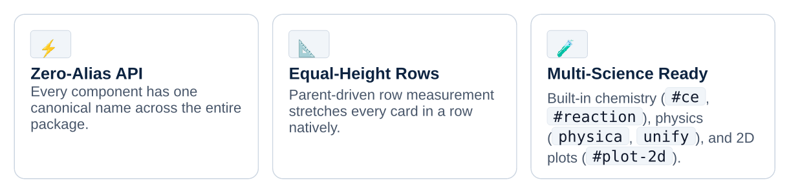

### Key-Value Grid

`#key-value-grid` renders a rounded two-column parameter and metadata directory with alternating zebra striping:

```typst
#key-value-grid(
  items: (
    ("Package Identifier", "@local/floe:0.2.2 (Universal Typst Package)"),
    ("Row Layout Engine", "#equal-grid with #metadata(\"floe-footer\") slack distribution"),
    ("Diagram Backends", "CeTZ 0.5.2 • Fletcher 0.5.8 • Merman 0.1.0 • Zap 0.5.0"),
  ),
)
```

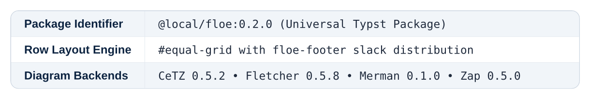

### Duality Grid

`#duality-grid` maps primal and dual mathematical structures row-by-row across a mirrored two-column table:

```typst
#duality-grid(
  left-title: "Controllability (Reachability)",
  right-title: "Observability (Constructibility)",
  left-badge: "PRIMAL (A, B)",
  right-badge: "DUAL (A^T, C^T)",
  rows: (
    ("Kalman Matrix", $cal(C) = mat(B, A B, dots, A^(n-1) B)$, "Observability Matrix", $cal(O) = mat(C; C A; dots.v; C A^(n-1))$),
    ("Gramian", $W_c = integral_0^oo e^(A tau) B B^top e^(A^top tau) dd(tau)$, "Gramian", $W_o = integral_0^oo e^(A^top tau) C^top C e^(A tau) dd(tau)$),
    ("Synthesis Problem", "State-Feedback Pole Placement u = -K x", "Synthesis Problem", "Luenberger State Observer Gain L"),
  ),
)
```

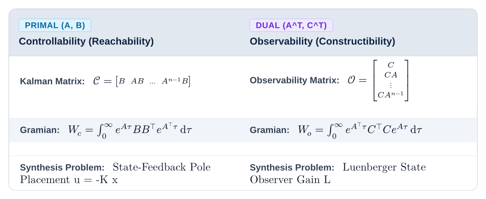

---

## Rounded Tables

**Source Module:** `components/tables.typ`

Clipped rounded-corner table containers with crisp sans-serif typography, repeating `table.header` rows across page breaks, and hairline internal cell dividers.

### Data Table

`#data-table` wraps standard Typst tables in a rounded `radii.md` frame with automatic fractional column sizing and `slate-200` / `slate-100` zebra striping:

```typst
#data-table(
  columns: (1.2fr, 1.2fr, 1fr, 0.9fr),
  headers: ("Method", "Iteration Complexity", "Memory Footprint", "Sparsity"),
  align: (left + horizon, center + horizon, center + horizon, center + horizon),
  [Gradient Descent], [$cal(O)(1 / epsilon)$], [$cal(O)(n)$], badge-no,
  [Newton Method], [$cal(O)(log log(1 / epsilon))$], [$cal(O)(n^2)$], badge-yes,
  [Primal-Dual Interior-Point], [$cal(O)(sqrt(n) log(1 / epsilon))$], [$cal(O)(n^3)$], badge-opt,
)
```

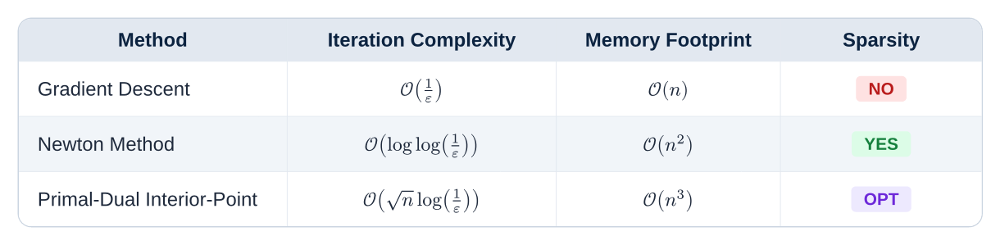

### Specification Table

`#spec-table` formats two-column technical specifications and configuration options with bold navy keys in the left column:

```typst
#spec-table(
  ("with-running-chrome", [Applies Hydra-powered running headers (`header-left`, `header-right`) and page footers.]),
  ("with-heading-theme", [Applies `Inter` typography, sticky anti-orphan protection (`sticky: true`), and hierarchical numbering.]),
  ("with-code-theme", [Styles ```` ```lang ```` blocks as macOS windows and intercepts ```` ```mermaid ```` blocks via `@preview/merman`.]),
)
```

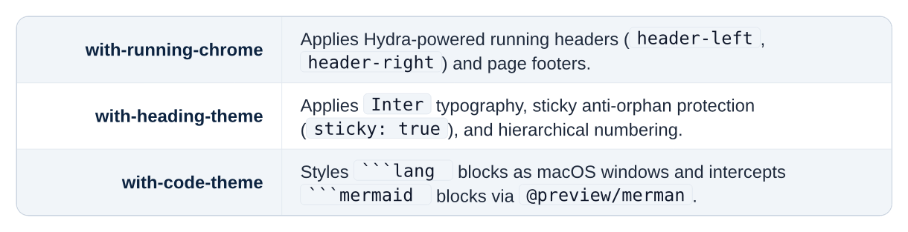

### Comparison Matrix Table

`#comparison-table` centers status chips (`#badge-yes`, `#badge-no`, `#badge-opt`) across feature and solver trade-study matrices:

```typst
#comparison-table(
  headers: ("Solver / Method", "Global Optimum", "Handles Nonconvex", "Uses Gradient"),
  ([Simplex / Interior-Point LP], badge-yes, badge-no, badge-yes),
  ([Sequential Quadratic Programming (SQP)], badge-no, badge-yes, badge-yes),
  ([Branch-and-Bound MILP], badge-yes, badge-opt, badge-no),
)
```

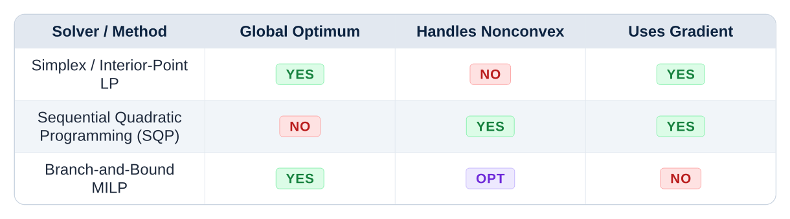

---

## Heroes and Section Headers

**Source Module:** `components/hero.typ`

Display banners, chapter openers, split heroes, KPI stat strips, and structural section headers. All twelve hero and header components follow Floe's corner-anchored bean row + stacked title geometry.

### Cover Hero

`#cover-hero` renders a high-impact dark-navy masthead with top corner-anchored eyebrow and badge pills, a bold display title, a cyan accent rule, and a bottom metadata grid:

```typst
#cover-hero(
  eyebrow: "FLOE ACADEMIC SERIES",
  badge-label: "#cover-hero",
  title: "Grand Cover & Monograph Masthead",
  subtitle: "High-impact dark-navy display banner with corner-anchored pills and bottom metadata strip",
  meta: (
    ("Layer", "Layer 3 — components/hero.typ"),
    ("Geometry", "Corner-Anchored Bean Row + Stacked Title"),
    ("Edition", "Zero-Alias Specification"),
  ),
)
```

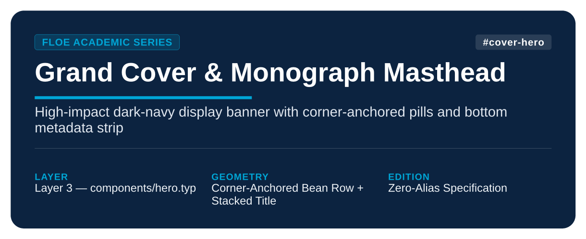

### Chapter Header

`#chapter-header` synchronizes Typst's heading counter to `num`, renders the corner-anchored chapter eyebrow and optional right badge, and displays a syllabus cross-reference bar (`slides-ref`, `reader-ref`, `teardown-ref`, or `meta`):

```typst
#chapter-header(
  num: 1,
  title: "First-Order Optimality Conditions",
  subtitle: "Unconstrained minimization, stationary points, and descent directions",
  eyebrow: "CHAPTER",
  badge-label: "CORE THEORY",
  slides-ref: "Lecture 01",
  reader-ref: "Sections 1.1–1.4",
  teardown-ref: "Lab 01: Gradient Flow",
  pagebreak-before: false,
)
```


### Split Hero

`#split-hero` pairs a dark-navy narrative headline column on the left with a vertically centered equation, diagram, or plot canvas on the right via `#equal-grid`:

```typst
#split-hero(
  tag: "SPLIT HERO",
  badge-label: "#split-hero",
  title: "Two-Column Narrative + Visual Hero",
  subtitle: "Pairs a dark-navy headline column on the left with a vertically centered equation or figure canvas on the right.",
  highlights: (
    [Equal-height left & right columns via `#equal-grid`.],
    [Vertically centered visual canvas on the right.],
  ),
  visual: [
    $ A = Q Lambda Q^top = sum_(i=1)^n lambda_i q_i q_i^top $
  ],
)
```

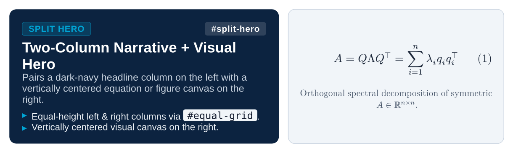

### Stat Hero

`#stat-hero` combines a dark-navy hero banner on top with an equal-height strip of color-coded KPI specification cards on the bottom:

```typst
#stat-hero(
  tag: "SYSTEM SPECIFICATION",
  badge-label: "#stat-hero",
  title: "Executive KPI & Specification Strip Hero",
  subtitle: "Combines a corner-anchored hero header with an equal-height bottom strip of KPI metric tiles",
  stats: (
    ("5 Layers", "Strict DAG Hierarchy", "Zero circular imports"),
    ("12 Heroes", "Header Archetypes", "In components/hero.typ"),
    ("6 Terms", "Universal Math Palette", "c-term-1 .. c-term-6"),
    ("0 Aliases", "Clean Public API", "Single canonical names"),
  ),
)
```


### Editorial Header

`#editorial-header` renders a magazine-style module opener with a reading-time badge and a bottom `LEARNING GOALS` strip:

```typst
#editorial-header(
  num: 4,
  eyebrow: "EDITORIAL MAGAZINE HEADER",
  title: "Spectral Methods & Fast Transforms",
  subtitle: "With reading-time indicator and learning goals pill bar",
  read-time: "12 min read",
  goals: ("DFT Matrix Factorization", "Radix-2 Butterfly", "Circulant Diagonalization"),
)
```


### Banner Header

`#banner-header` renders an in-page dark-navy part or topic transition card:

```typst
#banner-header(
  tag: "PART II • CONTINUUM MECHANICS",
  badge-label: "#banner-header",
  title: "Dark Navy Banner Part Opener",
  subtitle: "In-page major part or topic transition card with corner-anchored pills and stacked title",
)
```


### Section Header and Subchapter Card

`#section-header` renders a clean in-page section divider with corner-anchored beans and an accent rule, while `#subchapter-card` provides a left-accented syllabus lead-in card:

```typst
#section-header(
  tag: "SECTION 4.7",
  badge-label: "TOPIC SHIFT",
  title: "Section Header Banner",
  subtitle: "Clean in-page section divider with corner-anchored beans, title, and cyan rule",
)

#subchapter-card(
  tag: "SUBCHAPTER ROADMAP",
  badge-label: "PREREQUISITES",
  title: "Subchapter Syllabus Preview Card",
)[
  Used at the start of a section to summarize key topics, prerequisites, or reading roadmaps before diving into derivations.
]
```


### Document Header and Keynote Header

`#document-header` provides an executive report masthead with a structured metadata strip, and `#keynote-header` renders a 16:9 presentation slide banner (alongside `#minimal-header` and `#appendix-header`):

```typst
#document-header(
  tag: "TECHNICAL REPORT",
  badge-label: "FINAL",
  title: "System Identification & Spectral Audit",
  subtitle: "Clean executive document masthead with structured metadata strip",
  metadata: (("Author", "Floe Labs"), ("Status", "Approved"), ("Version", "v0.2.2")),
)

#keynote-header(
  tag: "KEYNOTE SLIDE HEADER",
  badge-label: "16:9 SLIDES",
  title: "16:9 Keynote Display Header",
  subtitle: "Used on presentation slide openers and executive report section dividers.",
)
```


---

## Universal Equation Dissection

**Source Module:** `components/math.typ`

Domain-agnostic term highlighters (`#t1` through `#t6` and `#math-hl(color, expr)`), annotated underbrace/overbrace macros (`#math-annot`, `#math-annot-top`), and `#eq-legend` allow any formula from any scientific or engineering discipline to be split and color-coded:

```typst
$
  #math-annot($rho (pdv(bold(u), t) + (bold(u) dot grad) bold(u))$, "Convective Acceleration", color: c-term-1) =
  #math-annot-top($-grad p$, "Pressure Gradient", color: c-term-2) +
  #math-annot($mu laplacian bold(u)$, "Viscous Diffusion", color: c-term-3) +
  #math-annot($bold(f)_("ext")$, "Body Force", color: c-term-4)
$

#eq-legend(
  ($rho (pdv(bold(u), t) + (bold(u) dot grad) bold(u))$, "Inertial & convective momentum transport per unit volume"),
  ($-grad p$, "Isotropic normal stress driving fluid from high to low pressure"),
  ($mu laplacian bold(u)$, "Internal shear stress dissipation governed by dynamic viscosity"),
  ($bold(f)_("ext")$, "Gravitational, Lorentz, or buoyancy force density"),
)
```

| Helper Function | Token Color | Behavior |
| :--- | :--- | :--- |
| `#t1(expr)` .. `#t6(expr)` | `c-term-1` .. `c-term-6` | Highlights any sub-expression in bold using the 6-color universal `term-palette` |
| `#math-hl(color, expr)` | Any `color` | Highlights `expr` in bold with an arbitrary color token |
| `#math-annot(expr, label, color: ...)` | Default `c-term-1` | Colored mathematical underbrace with sans-serif annotation label |
| `#math-annot-top(expr, label, color: ...)` | Default `c-term-1` | Colored mathematical overbrace with sans-serif annotation label |
| `#eq-legend(..items)` | Auto `term-palette` or custom | Renders a rounded legend card from 2-tuples `(sym, desc)` or 3-tuples `(color, sym, desc)` |

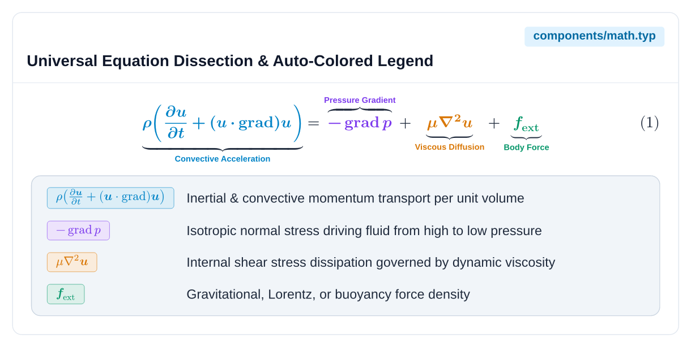
