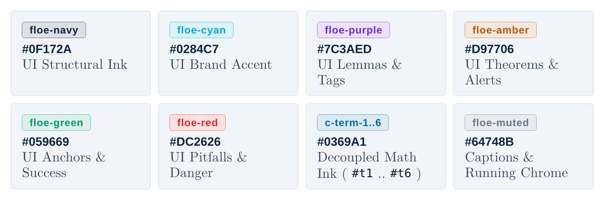
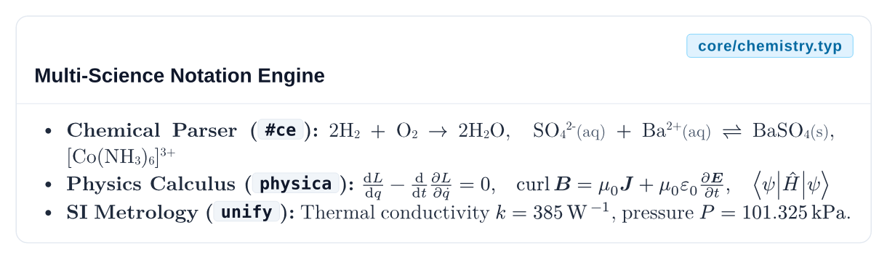

# Layer 0: Core Foundation

[Overview](README.md) • [Getting Started](getting-started.md) • [Core](core.md) • [Primitives](primitives.md) • [Mixins](mixins.md) • [Components](components.md) • [Presets](presets.md)

---

**Module:** `core/lib.typ` (`core/tokens.typ`, `core/packages.typ`, `core/chemistry.typ`)

Layer 0 defines the single source of truth for all palettes, monochromatic scales, semantic status tints, typography stacks, strokes, and radii across Floe, along with unified bindings to third-party drawing engines and a zero-dependency chemical formula parser.

---

## Design Tokens

**Source:** `core/tokens.typ`

### Floe Brand Palette

| Token | Hex Value | Typst Definition | Primary Usage |
| :--- | :--- | :--- | :--- |
| `floe-cyan` | `#00A6D6` | `rgb("#00A6D6")` | Primary accent, chapter rules, active links, info callouts |
| `floe-navy` | `#0C2340` | `rgb("#0C2340")` | Deep headings, primary titles, hero banners, dark table headers |
| `floe-slate` | `#334155` | `rgb("#334155")` | Body copy, secondary headers, default prose |
| `floe-muted` | `#64748B` | `rgb("#64748B")` | Captions, metadata labels, running breadcrumbs |
| `floe-green` | `#059669` | `rgb("#059669")` | Success badges, verification strips, physical intuition anchors |
| `floe-amber` | `#B45309` | `rgb("#B45309")` | Theorem accents, warning notices, exam alerts |
| `floe-red` | `#DC2626` | `rgb("#DC2626")` | Pitfalls, danger alerts, actuator saturation bounds |
| `floe-purple` | `#6D28D9` | `rgb("#6D28D9")` | Lemma accents, disturbance variables, optional tags |



### Neutral Slate Scale

Floe includes an 11-stop monochromatic scale aligned with Tailwind CSS Slate for subtle surface tints, hairlines, and high-contrast dark surfaces:

| Token | Hex Value | Typical Role |
| :--- | :--- | :--- |
| `slate-50` | `#F8FAFC` | Subtle card backgrounds, alternating table stripes |
| `slate-100` | `#F1F5F9` | Secondary panel fills, badge backgrounds, code gutters |
| `slate-200` | `#E2E8F0` | Hairline dividers, card borders, keycap rims |
| `slate-300` | `#CBD5E1` | Outer table borders, inactive stepper connectors |
| `slate-400` | `#94A3B8` | Placeholder icons, disabled metadata |
| `slate-500` | `#64748B` | Muted subcaptions, secondary labels (`floe-muted`) |
| `slate-600` | `#475569` | Aqueous/phase state annotations, secondary prose |
| `slate-700` | `#334155` | Primary body text (`floe-slate`) |
| `slate-800` | `#1E293B` | High-contrast titles, dark-mode card surfaces |
| `slate-900` | `#0F172A` | Deep dark-theme slide backgrounds |
| `slate-950` | `#020617` | Maximum-contrast ink and terminal surfaces |

### Semantic Status Tints

The `semantic` dictionary maps status names (`info`, `success`, `warning`, `danger`, `purple`, `neutral`) to coordinated `(bg, border, text)` triplets:

| Key | Background (`bg`) | Border (`border`) | Foreground (`text`) |
| :--- | :--- | :--- | :--- |
| `semantic.info` | `rgb("#F0F9FF")` | `floe-cyan` | `floe-navy` |
| `semantic.success` | `rgb("#ECFDF5")` | `floe-green` | `rgb("#065F46")` |
| `semantic.warning` | `rgb("#FFFBEB")` | `floe-amber` | `rgb("#92400E")` |
| `semantic.danger` | `rgb("#FEF2F2")` | `floe-red` | `rgb("#991B1B")` |
| `semantic.purple` | `rgb("#F5F3FF")` | `floe-purple` | `rgb("#5B21B6")` |
| `semantic.neutral` | `slate-50` | `slate-300` | `slate-800` |

### Universal Equation Term Palette

Floe provides six domain-agnostic mathematical ink tokens (`c-term-1` through `c-term-6`) and the ordered tuple `term-palette` for splitting and color-coding any mathematical, physical, chemical, or algorithmic equation (`#formula-breakdown`, `#eq-legend`, `#math-hl`, and `#t1`..`#t6`).

By default, `c-term-1`..`c-term-6` are **decoupled** from the UI chrome palette (`floe-cyan`, `floe-purple`, etc.) so re-theming document banners or callouts never alters equation ink contrast. To intentionally couple equation terms to the UI brand palette, pass `palette: brand-term-palette` (or any custom color array) to `#formula-breakdown` or `#eq-legend`:

| Token | Short Macro | Hex Value | Color Name | Typical Usage |
| :--- | :--- | :--- | :--- | :--- |
| `c-term-1` | `#t1(expr)` | `#0369A1` | Deep Cerulean | Primary left-hand side or Term 1 in any dissected equation |
| `c-term-2` | `#t2(expr)` | `#7E22CE` | Violet Ink | Second highlighted sub-expression or operator term |
| `c-term-3` | `#t3(expr)` | `#C2410C` | Rust Ochre | Third highlighted sub-expression, coupling, or gain term |
| `c-term-4` | `#t4(expr)` | `#0F766E` | Deep Teal | Fourth highlighted sub-expression, boundary, or source term |
| `c-term-5` | `#t5(expr)` | `#BE123C` | Carmine Rose | Fifth highlighted sub-expression, constraint, or dissipative term |
| `c-term-6` | `#t6(expr)` | `#4338CA` | Indigo Ink | Sixth highlighted sub-expression or auxiliary residual |

---

## Typography and Scales

**Source:** `core/tokens.typ`

### Font Stacks

The `fonts` dictionary defines cross-platform fallback chains that degrade cleanly across Linux, macOS, and Windows:

```typst
#let fonts = (
  serif:   ("New Computer Modern", "DejaVu Serif", "Times New Roman"),
  sans:    ("Liberation Sans", "DejaVu Sans", "Inter"),
  display: ("Liberation Sans", "Inter"),
  mono:    ("DejaVu Sans Mono", "Source Code Pro", "Consolas"),
)
```

### Typographic Scale

The `text-scale` dictionary provides a modular type hierarchy:

| Token | Size | Typical Usage |
| :--- | :--- | :--- |
| `text-scale.xs` | `7.5pt` | Badges, keycaps, running footers, micro-labels |
| `text-scale.sm` | `8.5pt` | Callout body text, table cells, figure captions |
| `text-scale.base` | `10pt` | Standard textbook and report body prose |
| `text-scale.md` | `11pt` | Lead paragraphs, subsection introductions |
| `text-scale.lg` | `12.8pt` | Level-2 section headings (`==`) |
| `text-scale.xl` | `16pt` | Subchapter titles, card hero numbers |
| `text-scale.title` | `18pt` | Level-1 chapter titles (`=`) |
| `text-scale.hero` | `24pt` | Presentation slide titles and banner headers |

### Radii, Strokes, and Spacing Rhythm

Consistent corner radii (`radii`), border weights (`strokes`), and vertical spacing rhythm (`space` / standard `em` and `pt` inset scales) ensure visual harmony across all cards, plaques, and tables:

```typst
#let radii = (
  "none": 0pt,
  sm:     2pt,      // Inline badges, keycaps, compact code blocks
  base:   3.5pt,    // Standard callouts and plaques
  md:     6pt,      // Cards, rounded tables, figure containers
  lg:     10pt,     // Hero banners and presentation cards
  full:   9999pt,   // Pill badges and circular step indicators
)

#let strokes = (
  hairline: 0.35pt, // Delicate inner table rules and subtle dividers
  border:   0.5pt,  // Standard card and plaque outer borders
  card:     0.75pt, // Emphasized container frames
  accent:   3.0pt,  // Left accent bars on plaques and alerts
  heavy:    4.5pt,  // Hero banner rules and thick callout borders
)
```

---

## Backend Packages

**Source:** `core/packages.typ`

Importing Floe (`#import "@local/floe:0.2.1": *`) automatically re-exports a curated suite of third-party Typst packages so you never have to manage versioned preamble imports across individual chapters:

| Package | Version | Exported Symbols | Purpose |
| :--- | :--- | :--- | :--- |
| `cetz` | `0.5.2` | `cetz` | 2D vector canvas drawing, plots, and coordinate geometry |
| `fletcher` | `0.5.8` | `fletcher`, `diagram`, `node`, `edge` | Commutative diagrams, block diagrams, and state machines |
| `physica` | `0.9.8` | `*` (`dv`, `pdv`, `grad`, `curl`, `dd`, `ket`, `bra`, ...) | Physics derivatives, vector calculus, Dirac brakets, and matrices |
| `merman` | `0.1.0` | `mermaid` | Native Typst rendering of Mermaid flowcharts and sequence diagrams |
| `tablex` | `0.0.9` | `tablex`, `cellx`, `hlinex`, `vlinex` | Legacy/advanced grid layout helpers |
| `lovelace` | `0.3.0` | `*` (`pseudocode-list`, `line-label`, ...) | Publication-grade algorithmic pseudocode listings |
| `unify` | `0.7.0` | `*` (`qty`, `num`, `unit`, `qtyrange`, ...) | SI units, scientific uncertainties, and engineering notation |
| `hydra` | `0.6.1` | `hydra` | Context-aware running header breadcrumbs |
| `zap` | `0.5.0` | `zap` | Electrical schematics and control circuit diagrams |

---

## Chemical Formula Parser

**Source:** `core/chemistry.typ`

Floe ships with `#ce(spec)`, a zero-dependency pure-Typst parser for chemical formulas, ionic charges, phase states, and stoichiometric reaction equations inspired by `mhchem`.

### Syntax Rules

- **Subscripts**: Numbers immediately following an element symbol or closing parenthesis/bracket are automatically typeset as subscripts (`H2SO4` renders as H₂SO₄, `[Fe(CN)6]^4-` subscripts the `6`).
- **Superscript Charges**: Caret notation `^2-`, `^3+`, `^+`, `^-`, or `^•` renders as a superscript ionic charge or radical dot.
- **Reaction Arrows**: Space-delimited arrow tokens convert automatically into mathematical reaction arrows:
  - `->`, `-->`, or `→` renders a forward reaction arrow (`→`)
  - `<=>`, `<-->`, or `⇌` renders reversible equilibrium harpoons (`⇌`)
  - `<->` or `↔` renders a resonance double-headed arrow (`↔`)
  - `<-` or `←` renders a reverse arrow (`←`)
- **Phase States**: `(s)`, `(l)`, `(g)`, and `(aq)` are styled in `0.82em` muted slate (`#475569`) whether attached to a species or space-separated.

### Usage Example

`#ce` pairs naturally with `unify` (`#qty`, `#unit`) for thermodynamics and `physica` (`$pdv(...)$`, `$dd(...)$`) for chemical kinetics:

```typst
#import "@local/floe:0.2.1": *

// Standalone formulas and redox stoichiometry
#ce("H2SO4(aq)")
#ce("Cr2O7^2- + 14 H^+ + 6 e^- -> 2 Cr^3+ + 7 H2O(l)")

// Reversible equilibrium with unify SI thermodynamics
#ce("N2(g) + 3 H2(g) <=> 2 NH3(g)") #h(1em) (Delta H^circle.stroked.tiny = #qty("-92.4", "kJ/mol"))
```


