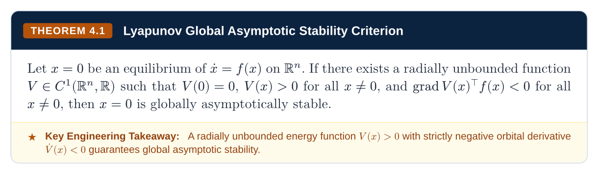

# Getting Started

[Overview](README.md) • [Getting Started](getting-started.md) • [Core](core.md) • [Primitives](primitives.md) • [Mixins](mixins.md) • [Components](components.md) • [Presets](presets.md)

---

## Installation

### Typst Universe

Import Floe directly in any Typst document from Typst Universe:

```typst
#import "@preview/floe:0.2.2": *
```

### Local Development

To link Floe into your local Typst package store for offline development or custom modifications:

```bash
mkdir -p ~/.local/share/typst/packages/local/floe
ln -s /path/to/Floe ~/.local/share/typst/packages/local/floe/0.2.2
```

Then import the local package in your `.typ` files:

```typst
#import "@local/floe:0.2.2": *
```

---

## Quick Start

Create a `main.typ` document with a textbook layout, chapter opener, theorem plaque, and exam pitfall:

```typst
#import "@local/floe:0.2.2": *

#show: textbook.with(
  title: "Optimal Control & Dynamic Programming",
  course-code: "SC42056",
  institution: "Systems & Control Institute • Academic Series",
)

#chapter-header(
  num: 1,
  title: "First-Order Optimality Conditions",
  subtitle: "Unconstrained minimization, stationary points, and descent directions",
  eyebrow: "FOUNDATION SPECIFICATION",
)

== Necessary Conditions

#theorem(
  num: "1.1",
  title: "First-Order Necessary Condition (FONC)",
  takeaway: [If $nabla f(x^*) eq.not 0$, the negative gradient $d = -nabla f(x^*)$ is a strict descent direction.],
)[
  Let $f: bb(R)^n -> bb(R)$ be continuously differentiable over an open set $cal(D) subset.eq bb(R)^n$.
  If $x^*$ is a local minimizer of $f$, then:
  $ nabla f(x^*) = 0 $
]

#pitfall(
  title: "Vanishing Gradient Fallacy",
  mistake: [$nabla f(x^*) = 0 arrow.double x^*$ is a local minimum],
  correct: [Check $nabla f(x^*) = 0$ AND $nabla^2 f(x^*) succ.eq 0$ (SONC)],
)[
  The condition $nabla f(x) = 0$ identifies stationary points, not minimizers. Saddle points and local maximizers also satisfy FONC.
]
```



Compile the document using the Typst CLI or Snowpack:

```bash
typst compile main.typ output.pdf
```

---

## Architecture

Floe is structured into five decoupled layers. You can use full document presets (`textbook`, `report`, `slides`, `cheatsheet`, `memo`, `adr`), cherry-pick high-level components (`theorem`, `formula-breakdown`, `sci-plot`, `data-table`), or compose pure layout atoms (`equal-row`, `card`, `plaque`, `stepper`) with zero external side effects:

```text
Floe/
├── core/                      # Layer 0: Tokens, scales, palettes, package bindings & #ce
│   ├── lib.typ
│   ├── tokens.typ
│   ├── packages.typ
│   └── chemistry.typ
├── primitives/                # Layer 1: Zero-domain layout geometry, cards, badges, steppers
│   ├── lib.typ
│   ├── layout.typ
│   ├── cards.typ
│   ├── plaques.typ
│   ├── figures.typ
│   ├── items.typ
│   ├── steppers.typ
│   ├── badges.typ
│   └── dividers.typ
├── mixins/                    # Layer 2: Pure show rules for chrome, headings, math, code, tables
│   ├── lib.typ
│   ├── chrome.typ
│   ├── headings.typ
│   ├── math.typ
│   ├── code.typ
│   ├── tables.typ
│   ├── callouts.typ
│   └── compact.typ
├── components/                # Layer 3: Academic callouts, explainers, plotting, layouts, tables
│   ├── lib.typ
│   ├── academic.typ
│   ├── alerts.typ
│   ├── pedagogical.typ
│   ├── scientific.typ
│   ├── layouts.typ
│   ├── tables.typ
│   ├── headers.typ
│   └── math-colors.typ
└── presets/                   # Layer 4: Master document templates
    ├── lib.typ
    ├── textbook.typ
    ├── report.typ
    ├── slides.typ
    ├── cheatsheet.typ
    ├── memo.typ
    └── adr.typ
```

### Granular Layer Imports

Every directory exposes a `lib.typ` entrypoint, allowing either whole-library or layer-specific imports:

```typst
// Import the entire Floe design system
#import "@local/floe:0.2.2": *

// Or import only specific layers into an existing template:
#import "@local/floe:0.2.2/core/lib.typ": floe-cyan, floe-navy, ce
#import "@local/floe:0.2.2/primitives/lib.typ": card, badge, stepper, equal-row
#import "@local/floe:0.2.2/mixins/lib.typ": with-heading-theme, with-code-theme
#import "@local/floe:0.2.2/components/lib.typ": theorem, definition, pitfall, formula-breakdown
#import "@local/floe:0.2.2/presets/lib.typ": textbook, report, slides
```
