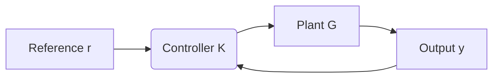
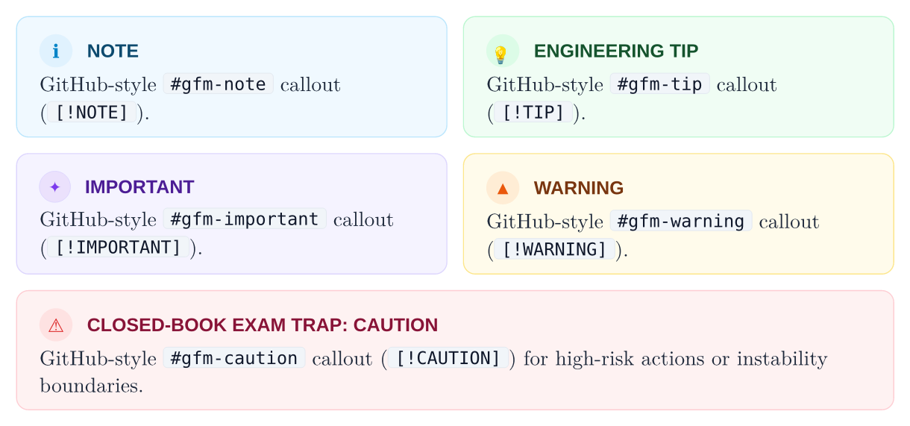

# Layer 2: Composable Mixins

[Overview](README.md) • [Getting Started](getting-started.md) • [Core](core.md) • [Primitives](primitives.md) • [Mixins](mixins.md) • [Components](components.md) • [Presets](presets.md)

---

Mixins are **pure `#show` rules** that format standard Typst and Markdown syntax into Floe themes without requiring authors to wrap content in custom functions. Every mixin can be applied independently via `#show: with-...` or composed together inside a document preset.

---

## Running Chrome

**Submodule:** `mixins/chrome.typ`

`with-running-chrome` configures dynamic page headers and footers with automatic [Hydra](https://typst.app/universe/package/hydra) chapter/section introspection and single-line clipping:

```typst
#show: with-running-chrome.with(
  header-left: none,
  header-right: none,
  footer-note: "Closed-Book Exam Reference • Systems & Control Series",
  suppress-pages: 1,
)
```

| Parameter | Default | Description |
| :--- | :--- | :--- |
| `header-left` | `none` | Custom left header content; falls back to `hydra(1)` (current level-1 heading) when `none` |
| `header-right` | `none` | Custom right header content; falls back to `hydra(2)` (current level-2 heading) when `none` |
| `footer-note` | `"Closed-Book Exam Reference..."` | Left-aligned footer text paired with `Page N` on the right |
| `suppress-pages` | `1` | Number of initial pages (e.g., cover page and TOC) where running headers and footers are suppressed |

- **Single-Line Clipping**: Wraps header slots in `box(width: 100%, clip: true)` so long section titles or inline code never wrap onto a second line or collide with the hairline divider rule.
- **Dynamic Breadcrumbs**: Automatically queries `hydra(1)` and `hydra(2)` when explicit header strings are omitted.

---

## Headings and Counters

**Submodule:** `mixins/headings.typ`

`with-heading-theme` styles level-1 through level-3 headings with crisp sans-serif typography, hierarchical numbering, and anti-orphan page-break protection:

```typst
#show: with-heading-theme.with(
  numbering: "1.1",
  section-symbol: false,
)
```

| Parameter | Default | Description |
| :--- | :--- | :--- |
| `numbering` | `"1.1"` | Heading numbering pattern passed to `set heading(numbering: ...)` |
| `section-symbol` | `false` | When `true`, prefixes level-2 headings with a cyan `§` section glyph |

- **Typographic Hierarchy**: Formats level-1 headings at `17pt` bold `floe-navy`, level-2 headings at `12pt` bold `floe-navy`, and level-3 headings at `10.5pt` bold `floe-slate`.
- **Anti-Orphan Protection**: Declares all headings with `block(sticky: true)` so a heading is never stranded at the bottom of a page without its following paragraph.
- **Chapter Header Synchronization**: Cooperates seamlessly with `#chapter-header(num: N)` from Layer 3.

---

## Math and Matrices

**Submodule:** `mixins/math.typ`

`with-math-theme` configures engineering matrix delimiters, equation numbering, and display block spacing:

```typst
#show: with-math-theme.with(
  numbering: "(1)",
  delim: "[",
)
```

| Parameter | Default | Description |
| :--- | :--- | :--- |
| `numbering` | `"(1)"` | Equation numbering format (`none` to disable numbering in slides or cheatsheets) |
| `delim` | `"["` | Default delimiter for `math.mat` and `math.vec` (`"["` for square brackets, `"("` for parentheses) |

- **Square Bracket Matrices**: Automatically sets `math.mat(delim: "[")` and `math.vec(delim: "[")` so state-space matrices and vectors render with standard engineering brackets.
- **Balanced Vertical Rhythm**: Configures block equations (`math.equation.where(block: true)`) with `0.9em` vertical margins.

---

## Code Blocks and Mermaid

**Submodule:** `mixins/code.typ`

`with-code-theme` transforms raw fenced code blocks, inline backtick code, and native Mermaid diagrams via a single `#show` rule:

- **macOS Terminal Code Windows**: Standard fenced code blocks (` ```lang `) are rendered inside a dark slate window (`#0F172A`) complete with a header bar (`#1E293B`), red/amber/green window control dots, and a monospace uppercase language badge (`RUST`, `PYTHON`, `TYPST`, etc.).
- **Native Mermaid Diagram Interception**: Fenced code blocks tagged with ` ```mermaid ` are automatically intercepted before terminal rendering and compiled into crisp native vector diagrams via `@preview/merman` (`mermaid(it.text, width: 88%, error-mode: "placeholder")`).
- **Inline Code Pills**: Inline raw spans (`` `code` ``) receive a `slate-100` background box with a subtle `slate-200` hairline border and rounded corners.

````typst
#show: with-code-theme

```rust
// Floe terminal code block with macOS window dots and language badge
pub fn compute_kalman_gain(p: &Matrix, c: &Matrix, r: &Matrix) -> Matrix {
    p * c.t() * (c * p * c.t() + r).inverse()
}
```


````


---

## Table Styling

**Submodule:** `mixins/tables.typ`

`with-table-theme` styles native Typst `#table(...)` elements and Markdown tables converted via Pandoc or `cmarker` without requiring `#data-table`:

```typst
#show: with-table-theme

#table(
  columns: (auto, 1fr, auto),
  [Method], [Convergence Rate], [Complexity],
  [Gradient Descent], [Linear $O(1 slash k)$], [$O(n)$ per step],
  [Newton-Raphson], [Quadratic $O(epsilon^(2^k))$], [$O(n^3)$ per step],
  [BFGS Quasi-Newton], [Superlinear], [$O(n^2)$ per step],
)
```

- **Header & Zebra Striping**: Styles row `y == 0` with a `slate-200` header fill and bold `floe-navy` text, while alternating body rows between `white` and `slate-100`.
- **Sans-Serif Tabular Alignment**: Applies `8.6pt` sans-serif typography (`fonts.sans`) with non-justified left alignment inside cells for clean numerical scanning.

---

## GitHub-Flavored Markdown Callouts

**Submodule:** `mixins/gfm.typ`

`with-gfm-theme` styles standard Typst `#quote` blocks as editorial pull quotes with a `2.5pt` cyan left accent bar and italic serif typography, while providing direct GFM callout helpers (`#gfm-note`, `#gfm-tip`, `#gfm-important`, `#gfm-warning`, `#gfm-caution`) for Markdown interoperability (`cmarker` / Pandoc pipelines):

| Helper Function | Underlying Mapping | Semantic Style |
| :--- | :--- | :--- |
| `#gfm-note[...]` | `#note[...]` | Sky blue `"info"` alert card |
| `#gfm-tip[...]` | `#tip[...]` | Emerald green `"success"` alert card |
| `#gfm-important[...]` | `#alert(variant: "tip", title: "IMPORTANT")[...]` | Purple `"tip"` alert card |
| `#gfm-warning[...]` | `#warning[...]` | Amber `"warning"` alert card |
| `#gfm-caution[...]` | `#pitfall(title: "CAUTION")[...]` | Crimson `"danger"` alert card |

```typst
#show: with-gfm-theme

#quote[
  Feedback is the central mechanism by which uncertain dynamical systems achieve precision in the presence of disturbances.
]

#gfm-note[First-order methods achieve sublinear convergence rate on general convex objectives.]
#gfm-tip[Preconditioning decision variables accelerates active-set identification.]
#gfm-important[Ensure observability rank condition holds before synthesizing the Luenberger gain.]
#gfm-warning[Actuator torque limit triggers integrator anti-windup clamping.]
#gfm-caution[Unmodeled time delay degrades phase margin and can destabilize high-gain loops.]
```



---

## Compact Mode

**Submodule:** `mixins/compact.typ`

`with-compact-theme` tightens base typography, paragraph leading, and block spacing for high-density layouts such as closed-book exam cheatsheets and reference cards:

```typst
#show: with-compact-theme
```

- Sets base font size to `8.5pt`.
- Reduces paragraph leading to `0.48em` and paragraph spacing to `0.65em`.
- Compresses default vertical block margins (`above` and `below`) to `0.55em`.
