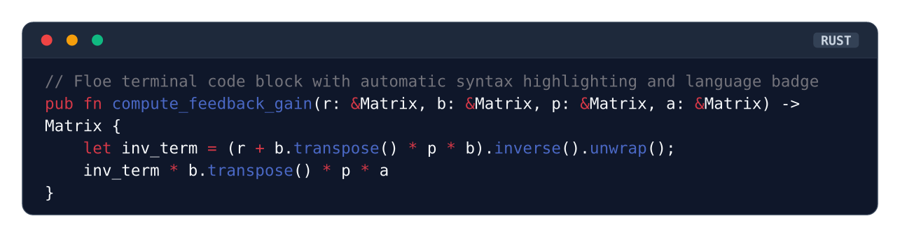

# Layer 2: Composable Mixins

[Overview](README.md) • [Getting Started](getting-started.md) • [Core](core.md) • [Primitives](primitives.md) • [Mixins](mixins.md) • [Components](components.md) • [Presets](presets.md)

---

Mixins are **pure `#show` rules** that format standard Typst and Markdown syntax into Floe themes without requiring authors to wrap content in custom functions.

---

## Headings & Counters

```typst
#show: with-heading-theme.with(
  numbering: "1.1",
  section-symbol: false,
)
```

- **Clean Numbering**: Automatically formats level-1 headings as `1. Title` and level-2 headings as `1.1 Title`.
- **Anti-Orphan Behavior**: Headings are declared with `sticky: true`, preventing headings from being separated from their introductory paragraphs across page breaks.
- **Counter Synchronization**: Seamlessly cooperates with `#chapter-header(num: X)`.

---

## Running Chrome & Breadcrumbs

```typst
#show: with-running-chrome.with(
  header-left: [Course Code • Title],
  header-right: context hydra(2),
  footer-note: [Systems & Control Series],
  suppress-pages: 2,
)
```

- **Single-Line Clipping**: Enforces `box(width: 100%, clip: true)`, preventing long headings or inline backtick code from wrapping over the hairline divider rule.
- **Dynamic Breadcrumbs**: Integrates with [Hydra](https://typst.app/universe/package/hydra) to automatically display current chapter and section names.
- **Page Suppression**: Silences headers and footers on cover pages and tables of contents.

---

## Code Blocks

```typst
#show: with-code-theme

```rust
// Floe terminal code block with automatic syntax highlighting and language badge
pub fn compute_feedback_gain(r: &Matrix, b: &Matrix, p: &Matrix, a: &Matrix) -> Matrix {
    (r + b.t() * p * b).inverse() * b.t() * p * a
}
```
```



---

## Math & Matrix Formatting

```typst
#show: with-math-theme.with(
  delim: "[",
  numbering: "(1)",
)
```

- Automatically configures matrices (`math.mat`) and vectors (`math.vec`) to use engineering bracket delimiters (`[...]`) instead of parentheses.
- Sets equation numbering and vertical equation block margins.

---

## GitHub-Flavored Markdown Callouts

```typst
#show: with-gfm-theme
```

When importing Markdown converted via Pandoc or `cmarker`, standard GitHub blockquotes (`> [!NOTE]`, `> [!WARNING]`, `> [!TIP]`) are automatically rendered as Floe alert cards.

You can also use direct GFM helpers:

```typst
#gfm-note[First-order methods achieve sublinear convergence rate.]
#gfm-tip[Preconditioning decision variables accelerates active set detection.]
#gfm-warning[Torque limit triggers integrator anti-windup clamping.]
```


