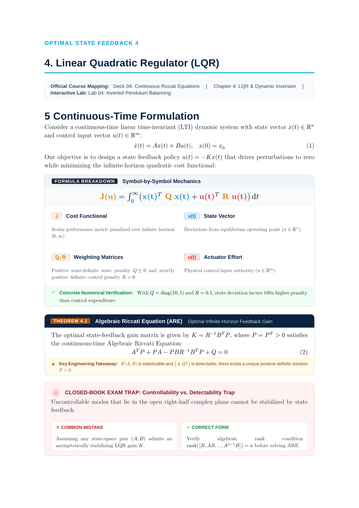
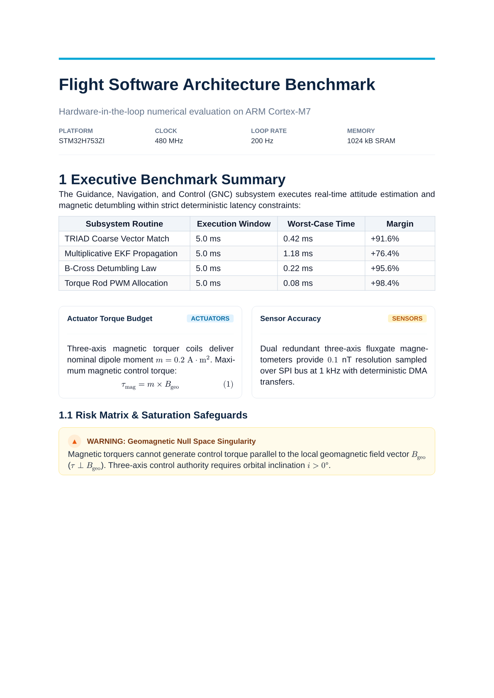
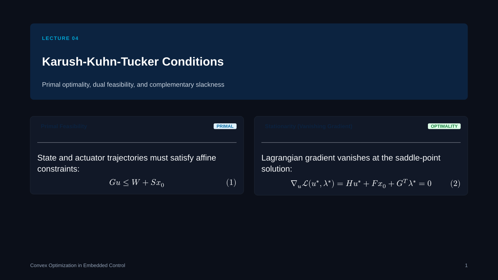
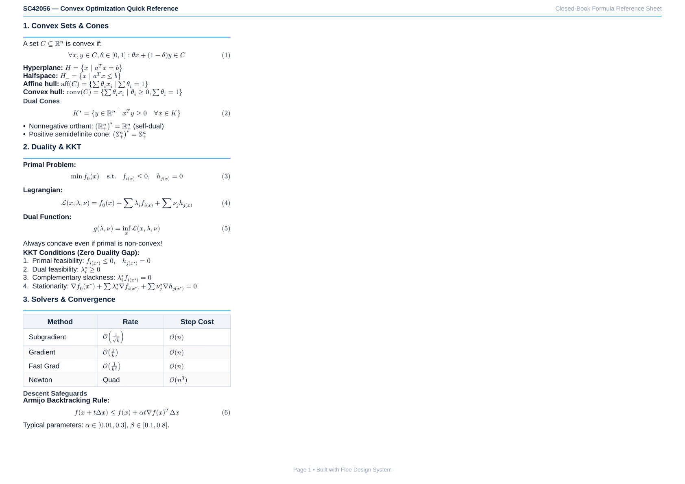
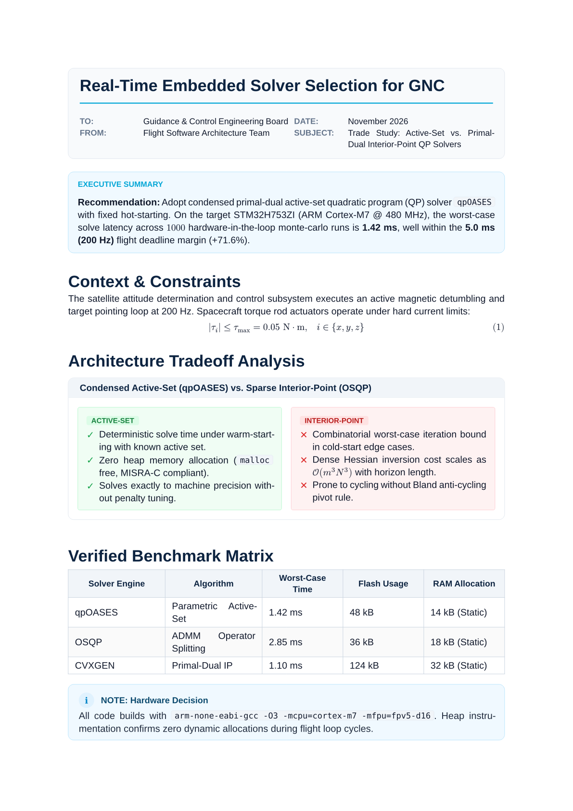
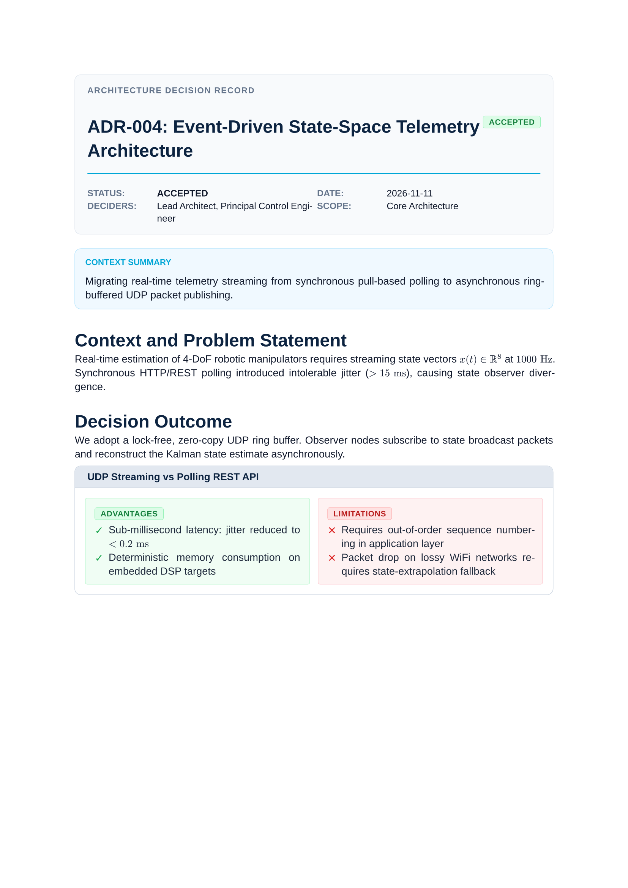
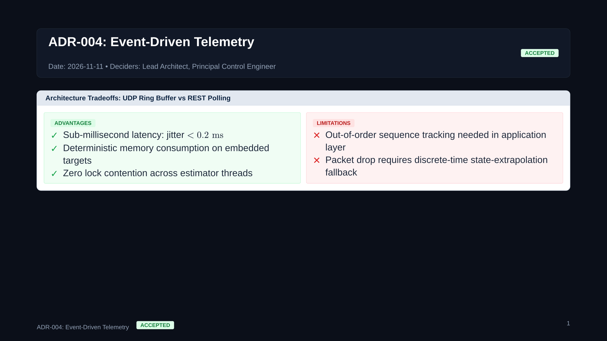

# Layer 4: Document Presets

[Overview](README.md) • [Getting Started](getting-started.md) • [Core](core.md) • [Primitives](primitives.md) • [Mixins](mixins.md) • [Components](components.md) • [Presets](presets.md)

---

Presets are ready-to-use master document wrappers in `presets/`. Each preset configures page geometry, margins, typographic hierarchy, anti-orphan heading rules, math/code/table mixins, and running headers in a single `#show` call.

---

## Textbook Companion

**Source Module:** `presets/textbook.typ`

Full single-column publication-grade course reader and textbook companion with an automatic navy cover plaque, table of contents, `1.1` section numbering, and Hydra-powered running chapter/section headers:

```typst
#import "@local/floe:0.2.2": *

#show: textbook.with(
  title: "Optimal Control & Dynamic Programming",
  subtitle: "State-Space Feedback, Riccati Equations & Bellman Optimality",
  course-code: "SC42056",
  institution: "Systems & Control Institute • Academic Series",
  edition: "Comprehensive Companion Edition",
  toc: true,
)

#chapter-header(
  num: 1,
  title: "Linear-Quadratic Regulator Theory",
  subtitle: "Continuous-time Hamilton-Jacobi-Bellman equations and Riccati synthesis",
  slides-ref: "Lecture 01–02",
)
```



*Standalone Example:* [`examples/textbook_example.typ`](../examples/textbook_example.typ)

---

## Engineering Report

**Source Module:** `presets/report.typ`

Clean sans-serif technical report layout with A4 geometry, hierarchical section numbering, and suppressed running headers on the opening page:

```typst
#import "@local/floe:0.2.2": *

#show: report.with(
  title: "Autonomous Spacecraft Attitude Determination & Control",
  subtitle: "Critical Design Review & Subsystem Benchmark",
  author: "Guidance, Navigation & Control Team",
  date: "November 2026",
)

#document-header(
  title: "Autonomous Spacecraft Attitude Determination & Control",
  subtitle: "Critical Design Review & Subsystem Benchmark",
  metadata: (
    ("DOCUMENT ID", "GNC-CDR-2026"),
    ("AUTHOR", "GNC Architecture Team"),
    ("STATUS", "RELEASED"),
    ("DATE", "November 2026"),
  ),
)
```



*Standalone Example:* [`examples/report_example.typ`](../examples/report_example.typ)

---

## Presentation Slides

**Source Module:** `presets/slides.typ`

16:9 widescreen presentation slide deck with `theme: "dark"` and `theme: "light"` modes, paired with `#keynote-header` and `#equal-grid` split cards:

```typst
#import "@local/floe:0.2.2": *

#show: slides.with(
  title: "Convex Optimization in Embedded Control",
  theme: "dark",
)

#keynote-header(
  tag: "LECTURE 04",
  title: "Karush-Kuhn-Tucker Optimality Conditions",
  subtitle: "Primal feasibility, dual feasibility, stationarity, and complementary slackness",
)
```



*Standalone Example:* [`examples/slides_example.typ`](../examples/slides_example.typ)

---

## Formula Cheatsheet

**Source Module:** `presets/cheatsheet.typ`

High-density 2-column or 3-column landscape reference sheet with `with-compact-theme` spacing and sticky cyan-underlined section headers for closed-book exam preparation:

```typst
#import "@local/floe:0.2.2": *

#show: cheatsheet.with(
  title: "Convex Optimization Quick Reference",
  course-code: "SC42056",
  columns-num: 3,
  paper: "a4",
  orientation: "landscape",
)

= 1. First- & Second-Order Conditions
For $f in C^2(RR^n)$, $x^*$ is a strict local minimizer if $grad f(x^*) = 0$ and $nabla^2 f(x^*) succ 0$.
```



*Standalone Example:* [`examples/cheatsheet_example.typ`](../examples/cheatsheet_example.typ)

---

## Decision Memo

**Source Module:** `presets/memo.typ`

Executive engineering brief featuring a structured `TO` / `FROM` / `DATE` / `SUBJECT` metadata header plaque and an optional sky-blue `EXECUTIVE SUMMARY` callout:

```typst
#import "@local/floe:0.2.2": *

#show: memo.with(
  title: "Real-Time Embedded Solver Selection for GNC",
  to: "Guidance & Control Engineering Board",
  from: "Flight Software Architecture Team",
  date: "November 2026",
  subject: "Trade Study: Active-Set vs. Primal-Dual Interior-Point QP Solvers",
  summary: [
    *Recommendation:* Adopt condensed primal-dual active-set quadratic program solver `qpOASES` with warm-started working sets for the 200 Hz control loop.
  ],
)
```



*Standalone Example:* [`examples/memo_example.typ`](../examples/memo_example.typ)

---

## Architecture Decision Records

**Source Module:** `presets/adr.typ`

Floe's Architecture Decision Record preset (`#show: adr.with(...)`) implements a **single-source dual-target** workflow: the exact same ADR document compiles into either a print-ready A4 technical decision document (`mode: "document"`) or a 16:9 widescreen architectural review deck (`mode: "slides"`) by toggling a single parameter.

- **`mode: "document"`**: Configures A4 portrait geometry, running headers, metadata plaque (`STATUS`, `DATE`, `DECIDERS`, `SCOPE`), and an optional sky-blue `CONTEXT SUMMARY` box.
- **`mode: "slides"`**: Configures 16:9 widescreen dark presentation mode (`#0B0F19`), rendering a dark header plaque with status badge, date, deciders, and slide footer.

```typst
#import "@local/floe:0.2.2": *

#show: adr.with(
  title: "ADR-004: Event-Driven State-Space Telemetry Architecture",
  status: "accepted", // "proposed" | "accepted" | "rejected" | "deprecated" | "superseded"
  date: "2026-11-11",
  deciders: ("Lead Architect", "Principal Control Engineer"),
  summary: [
    Migrating real-time telemetry streaming from synchronous pull-based polling to asynchronous ring-buffered UDP packet publishing.
  ],
  mode: "document", // Switch to "slides" for a 16:9 presentation deck!
)

= Context and Problem Statement

Real-time estimation of 4-DoF robotic manipulators requires streaming state vectors $x(t) in RR^8$ at $1000 upright("Hz")$. Synchronous HTTP/REST polling introduced intolerable jitter ($> 15 upright("ms")$).

= Decision Outcome

We adopt a lock-free, zero-copy UDP ring buffer with `#pro-con` tradeoff analysis:

#pro-con(
  title: "UDP Streaming vs Polling REST API",
  pros: (
    [Sub-millisecond latency: jitter reduced to $< 0.2 upright("ms")$],
    [Deterministic memory consumption on embedded DSP targets],
  ),
  cons: (
    [Requires out-of-order sequence numbering in application layer],
    [Packet drop on lossy WiFi networks requires state-extrapolation fallback],
  ),
)
```




