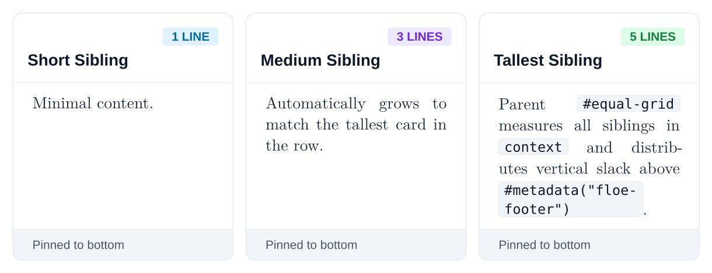
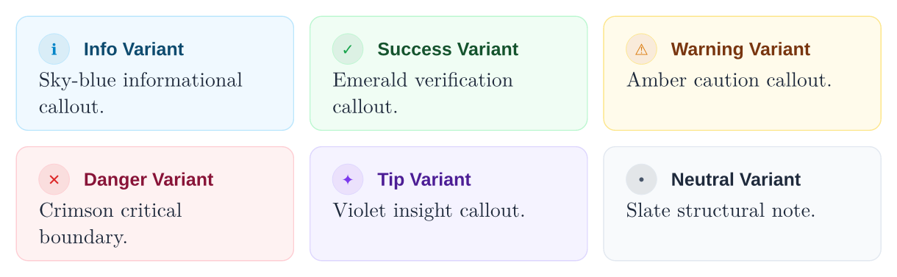
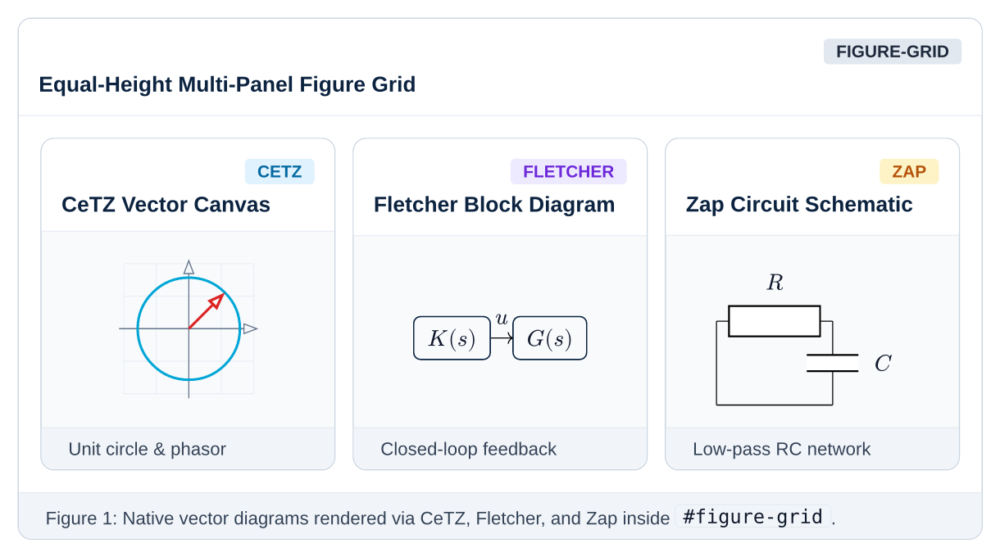
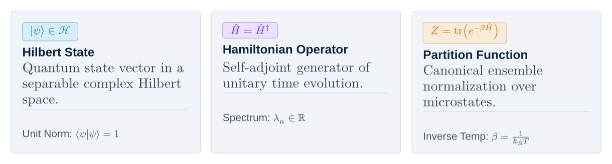

# Layer 1: Atomic Primitives

[Overview](README.md) • [Getting Started](getting-started.md) • [Core](core.md) • [Primitives](primitives.md) • [Mixins](mixins.md) • [Components](components.md) • [Presets](presets.md)

---

Primitives are **zero-domain layout atoms**. They handle borders, backgrounds, padding geometry, equal-height row sizing, and inline alignment without making assumptions about whether the content is a mathematical theorem, a code tutorial, or an executive brief.

---

## Equal-Height Row Engine

**Submodule:** `primitives/grid.typ`

In multi-column Typst layouts, sibling containers with differing content lengths normally render at uneven heights. Floe solves this at the foundation layer via a parent-driven row equalization engine (`#equal-grid` and `#stretch-cell`) that automatically measures every child in each row, stretches all cells in the row to match the tallest sibling, and pins internal footers (`#metadata("floe-footer")`) to the bottom edge while centering visual media (`#metadata("floe-stretch-center")`).

### Equal-Grid Parameters

| Parameter | Default | Description |
| :--- | :--- | :--- |
| `columns` | `(1fr, 1fr)` | Column track array (e.g., `(1fr, 1fr, 1fr)`) or integer column count |
| `gutter` | `8pt` | Unified horizontal column-gutter and vertical row-gutter |
| `above` / `below` | `8pt` | Vertical block spacing around the grid |
| `..items` | — | Positional child blocks (`#card`, `#plaque`, `#item-card`, `#figure-card`, or raw `block`) |

### Stretch-Cell Helper

```typst
#stretch-cell(cell-block, target-height, slack: 0pt)
```

Reconstructs any top-level `block` at `target-height` while preserving its `fill`, `stroke`, `radius`, `inset`, and `clip` properties, distributing vertical `slack` across internal `#metadata("floe-footer")` or `#metadata("floe-stretch-center")` markers.

```typst
#equal-grid(
  columns: (1fr, 1fr),
  gutter: 8pt,
  card(
    title: "Short Sibling Card",
    badge-label: "AUTO-STRETCH",
    badge-variant: "info",
    footer: [Pinned to bottom edge via `#metadata("floe-footer")`.],
  )[
    Single line of content that stretches to match its taller neighbor.
  ],
  card(
    title: "Tall Sibling Card",
    badge-label: "REFERENCE HEIGHT",
    badge-variant: "purple",
    footer: [Both footers align on the exact same baseline.],
  )[
    This card contains multiple paragraphs and equations:
    $ J(u) = integral_0^T (x^T Q x + u^T R u) dif t $
    The parent `#equal-grid` measures both cards in layout context and equalizes their row height automatically.
  ],
)
```



---

## Cards and Alerts

**Submodule:** `primitives/card.typ`

### Structural Card

The general-purpose Shadcn-inspired container primitive (`#card`) with subtle hairline borders, rounded corners, an optional icon/title/badge header divider, and a bottom-aligned footer:

| Parameter | Default | Description |
| :--- | :--- | :--- |
| `title` | `none` | Bold header title (`10.5pt` sans-serif) |
| `description` | `none` | Muted subtitle displayed beneath the header title |
| `badge-label` | `none` | Optional pill badge text on the top-right header |
| `badge-variant` | `"neutral"` | Semantic variant for the header badge (`"info"`, `"success"`, `"warning"`, `"danger"`, `"purple"`, `"neutral"`, `"outline"`) |
| `icon` | `none` | Optional icon or glyph box on the top-left header |
| `footer` | `none` | Bottom-pinned slate footer banner |
| `fill` | `white` | Card background color |
| `border-color` | `slate-200` | Outer border stroke color |
| `radius` | `radii.md` | Corner radius (`5pt`) |
| `inset` | `12pt` | Internal padding |
| `breakable` | `true` | Whether the card can break across pages |

```typst
#card(
  title: "Shadcn Card Primitive",
  description: "Zero-domain structural container with header & footer slots",
  badge-label: "ATOMIC",
  badge-variant: "info",
  footer: [*Footer Slot:* Automatically pinned to the bottom edge inside equal-height grids.],
)[
  This is a raw container primitive with subtle hairline borders, rounded corners, and a clean header divider.
]
```


### Base Alert

The modern callout container (`#alert`) featuring a full-perimeter tinted border, rounded icon chip, bold header title, and zero left-bar monoculture:

| Parameter | Default | Description |
| :--- | :--- | :--- |
| `variant` | `"info"` | Semantic palette (`"info"`, `"success"`, `"warning"`, `"danger"`, `"tip"`, `"neutral"`) |
| `title` | `none` | Bold uppercase or title-case callout heading |
| `icon` | `auto` | Custom icon content, or `auto` for the semantic circular glyph chip |
| `style` | `"filled"` | `"filled"` (soft pastel background) or `"outline"` (crisp white background) |
| `breakable` | `false` | Keeps short alerts intact across page boundaries |

```typst
#alert(variant: "info", title: "Information Alert")[
  Full-perimeter sky border with circular icon badge and zero thick left bar.
]
#alert(variant: "success", title: "Verification Passed")[
  Lyapunov decrease condition verified across all boundary vertices.
]
#alert(variant: "warning", title: "Actuator Saturation Warning")[
  Control input clamp active near peak slewing rate.
]
#alert(variant: "danger", title: "Numerical Instability")[
  Explicit Euler diverges when step size exceeds the stability threshold.
]
```



---

## Academic Plaques

**Submodule:** `primitives/plaque.typ`

Plaques (`#plaque`) are the master container primitive that powers all academic blocks (`#theorem`, `#definition`, `#lemma`, `#corollary`, `#proposition`, `#algorithm`). They feature a bold uppercase tag pill, optional dark or light header bar, `title-below` mode for long academic titles, and a warm amber takeaway footer.

| Parameter | Default | Description |
| :--- | :--- | :--- |
| `tag` | `none` | Uppercase category pill text (e.g., `"THEOREM"`, `"DEFINITION"`) |
| `num` | `none` | Theorem or section number appended inside the tag pill (e.g., `"2.1"`) |
| `title` | `none` | Title of the theorem, definition, or algorithm |
| `subtitle` | `none` | Optional secondary attribution or complexity note |
| `badge-label` | `none` | Right-aligned pill badge inside the header |
| `badge-variant` | `"outline"` | Badge variant (`"info"`, `"success"`, `"warning"`, `"danger"`, `"purple"`, `"outline"`) |
| `accent` | `floe-navy` | Primary color of the tag pill and border tint |
| `header-fill` | `auto` | Header bar background (`floe-navy` for high-contrast dark headers, or `slate-100` when `auto`) |
| `title-below` | `false` | When `true`, places long titles on a dedicated second row in the header so they never collide with tags or badges |
| `footer` | `none` | Bottom-pinned takeaway or intuition banner |
| `breakable` | `true` | Allows long proofs or algorithms to break cleanly across pages |

```typst
#plaque(
  tag: "THEOREM",
  num: "2.1",
  title: "First-Order Necessary Optimality Condition",
  badge-label: "FOUNDATIONAL",
  badge-variant: "warning",
  accent: floe-amber,
  header-fill: floe-navy,
  title-below: true,
  footer: [*Geometric Intuition:* At a local unconstrained minimum, the gradient vanishes in all feasible directions.],
)[
  Let $f : RR^n -> RR$ be continuously differentiable on an open set $Omega subset RR^n$. If $x^* in Omega$ is a local minimizer of $f$, then:
  $ nabla f(x^*) = 0 $
]
```


---

## Figures and Media Grids

**Submodule:** `primitives/figure.typ`

`#figure-card` and `#figure-grid` provide framed visual containers for plots, images, and native vector diagrams (CeTZ, Fletcher, Lilaq, Zap). Inside `#figure-grid`, panels in the same row automatically stretch to equal height while vertically centering their canvas artwork via `#metadata("floe-stretch-center")`.

| Function | Key Parameters | Description |
| :--- | :--- | :--- |
| `#figure-card` | `title`, `subtitle`, `badge-label`, `badge-variant`, `footer` (or `caption`), `canvas-fill: rgb("#F8FAFC")`, `img-width: 90%` | Framed media container. If `body` is a string path, renders `#image(body, width: img-width)`; otherwise renders arbitrary Typst/CeTZ/Fletcher content |
| `#figure-grid` | `columns: (1fr, 1fr)`, `gutter: 8pt`, `title: none`, `badge-label: none`, `footer: none`, `..items` | Arranges multiple `#figure-card` panels or diagrams in an equal-height row grid, optionally wrapped in a shared master header and caption footer |

```typst
#figure-grid(
  columns: (1fr, 1fr),
  gutter: 8pt,
  figure-card(
    title: "Closed-Loop Block Diagram",
    badge-label: "FLETCHER",
    badge-variant: "info",
    footer: [*Figure 1a:* State-feedback topology rendered via `@preview/fletcher`.],
  )[
    #fletcher.diagram(
      node-stroke: 0.8pt + floe-navy,
      node((0, 0), [$r_k$]),
      edge("->", [$+$]),
      node((1, 0), [$K(z)$], fill: floe-sky),
      edge("->", [$u_k$]),
      node((2, 0), [$G(z)$], fill: slate-100),
    )
  ],
  figure-card(
    title: "Phase Portrait Trajectory",
    badge-label: "CETZ",
    badge-variant: "purple",
    footer: [*Figure 1b:* Asymptotic spiral convergence rendered via `@preview/cetz`.],
  )[
    #cetz.canvas(length: 0.9cm, {
      import cetz.draw: *
      line((-2, 0), (2, 0), stroke: 0.5pt + slate-400)
      line((0, -1.2), (0, 1.2), stroke: 0.5pt + slate-400)
      circle((0, 0), radius: (1.4, 0.9), stroke: 1.2pt + floe-cyan)
    })
  ],
)
```



---

## Item Cards and Grids

**Submodule:** `primitives/item.typ`

`#item-card` and `#item-grid` are compact, high-density building blocks designed for symbol legends, term breakdowns, parameter catalogs, and bento cells. Each `#item-card` pairs a tinted top bean (`label`) and bold `title` with a full-width unpadded body and an optional bottom-pinned `footer`.

| Function | Key Parameters | Description |
| :--- | :--- | :--- |
| `#item-card` | `label: none`, `title: none`, `footer: none`, `color: floe-navy`, `fill: slate-100`, `stroke: slate-300` | Compact card with a tinted pill bean (`label`), bold `title`, full-width body, and bottom-aligned `footer` |
| `#item-grid` | `columns: (1fr, 1fr)`, `gutter: 8pt`, `above: 8pt`, `below: 8pt`, `..items` | Equal-height multi-column grid wrapper powered by `#equal-grid` |

```typst
#item-grid(
  columns: (1fr, 1fr, 1fr),
  gutter: 8pt,
  item-card(
    label: $x_k in RR^n$,
    title: "State Vector",
    color: floe-cyan,
    footer: [Units: $"rad"$, $"rad/s"$],
  )[
    Instantaneous plant coordinates at sampling instant $k$.
  ],
  item-card(
    label: $u_k in RR^m$,
    title: "Control Input",
    color: floe-amber,
    footer: [Subject to $|u_k| <= u_"max"$],
  )[
    Actuator command computed by the feedback policy.
  ],
  item-card(
    label: $P succ 0$,
    title: "Lyapunov Matrix",
    color: floe-green,
    footer: [Solved via DARE],
  )[
    Symmetric positive-definite quadratic cost-to-go matrix.
  ],
)
```



---

## Steppers and Timelines

### Ordered Stepper

**Submodule:** `primitives/stepper.typ`

Displays ordered algorithms, execution pipelines, or mathematical derivations as a structured three-column workflow table (`#stepper`) with circular step badges, bold action labels, and aligned mathematical detail:

| Parameter | Default | Description |
| :--- | :--- | :--- |
| `steps` | `()` | Array of `(title, body)` 2-tuples or `(num-label, title, body)` 3-tuples |
| `zebra` | `false` | Enables alternating `slate-100` row backgrounds when `true` |
| `inset` | `(x: 6pt, y: 5.5pt)` | Cell padding inside each workflow row |

```typst
#stepper(
  zebra: true,
  steps: (
    (1, "Formulate Condensed QP", [Eliminate internal states $x_k$ via batch state-transition recursion.]),
    (2, "Factorize Hessian", [Perform Cholesky decomposition $H = L L^T$ offline in $O(N^3 m^3)$.]),
    (3, "Solve Active Set", [Iterate primal-dual active-set solver until tolerance $epsilon <= 10^(-6)$.]),
  )
)
```


### Execution Timeline

**Submodule:** `primitives/timeline.typ`

Displays chronological event sequences and hardware execution pipelines (`#timeline`) with numbered circular milestones connected by vertical rails:

```typst
#timeline(
  ("IMU Sensor Sampling", [Sample angular body rate gyroscope and magnetometer vector at $1 "kHz"$.]),
  ("EKF State Propagation", [Integrate quaternion kinematics and perform covariance time-update step.]),
  ("Actuator Allocation", [Compute optimal magnetic dipole moment and clamp saturation limits.]),
)
```


---

## Badges and Keycaps

**Submodule:** `primitives/badge.typ`

Semantic status tags (`#badge`), tactile keyboard keycap visualizations (`#kbd`), and inline status indicator dots (`#status-dot`):

| Function | Signature / Parameters | Description |
| :--- | :--- | :--- |
| `#badge` | `badge(label, variant: "neutral", fill: none, text-color: none)` | Inline pill tag supporting `"info"`, `"success"`, `"warning"`, `"danger"`, `"purple"`, `"neutral"`, and `"outline"` |
| `#kbd` | `kbd(key)` | Tactile monospace keycap box with 3D bottom bezel stroke |
| `#status-dot` | `status-dot(color: floe-green, size: 5pt)` | Circular status indicator aligned to the inline text baseline |

```typst
*Status Badges:*
#badge("STABLE", variant: "success")
#badge("CRITICAL", variant: "danger")
#badge("OPTIMAL", variant: "purple")
#badge("INFO", variant: "info")
#badge("WARNING", variant: "warning")
#badge("NEUTRAL", variant: "neutral")
#badge("OUTLINE", variant: "outline")

*Keyboard Caps:*
Press #kbd("Ctrl") + #kbd("Shift") + #kbd("P") or #kbd("⌘") + #kbd("K")

*Status Indicators:*
#status-dot(color: floe-green) Online
#h(8pt)
#status-dot(color: floe-amber) Solving
#h(8pt)
#status-dot(color: floe-red) Saturated
```


---

## Section Dividers

**Submodule:** `primitives/divider.typ`

Floe provides eight canonical divider primitives for structural pacing, subtle line rules, clean text breaks, boxed section chips, and visual accents:

| Function | Signature | Description |
| :--- | :--- | :--- |
| `#divider` | `divider(color: slate-300, thickness: strokes.hairline)` | Subtle horizontal hairline rule |
| `#dotted-divider` | `dotted-divider(color: slate-300, thickness: 1.0pt)` | Dotted horizontal separator line |
| `#dashed-divider` | `dashed-divider(color: slate-300, thickness: 0.8pt)` | Dashed horizontal separator line |
| `#fade-divider` | `fade-divider(color: slate-400, thickness: strokes.border)` | Linear gradient rule that fades in from the left margin and fades out on the right |
| `#gradient-divider` | `gradient-divider(from-color: floe-cyan, to-color: floe-navy, thickness: 1.5pt)` | Dual-color brand accent rule |
| `#text-divider` | `text-divider(label, color: slate-300, text-color: floe-slate)` | Centered uppercase tracking label flanked by hairline rules (no box border) |
| `#chip-divider` | `chip-divider(label, color: slate-300, text-color: floe-navy, badge-fill: slate-100)` | Centered pill chip badge with tinted background and border flanked by hairline rules |
| `#icon-divider` | `icon-divider(icon: "✦", color: slate-300, icon-color: floe-cyan)` | Centered glyph or emblem flanked by hairline rules |

```typst
// 1. Hairline rule
#divider()

// 2. Dotted divider line
#dotted-divider(color: slate-300)

// 3. Dashed divider line
#dashed-divider(color: slate-300)

// 4. Gradient fade divider
#fade-divider(color: floe-cyan)

// 5. Brand dual-color linear gradient
#gradient-divider(from-color: floe-cyan, to-color: floe-navy)

// 6. Pure text divider
#text-divider("CONTINUATION SPECIFICATION")

// 7. Boxed pill chip divider
#chip-divider("SECTION BREAK")

// 8. Glyph emblem divider
#icon-divider(icon: "✦", icon-color: floe-cyan)
```


