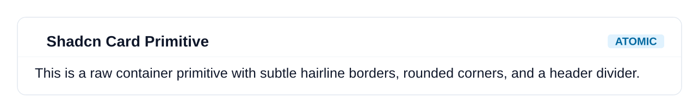
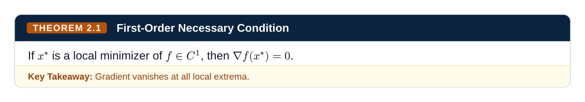
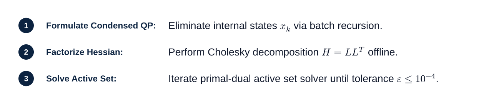
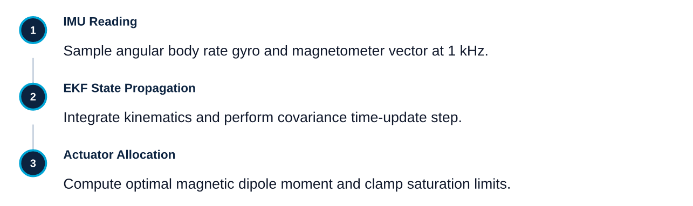
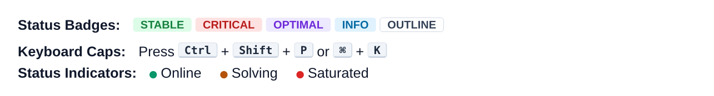
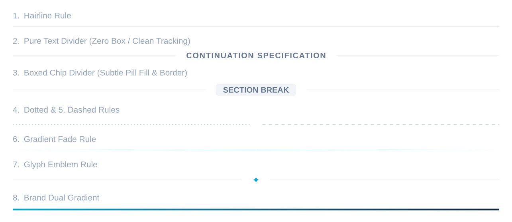

# Layer 1: Atomic Primitives

[Overview](README.md) • [Getting Started](getting-started.md) • [Core](core.md) • [Primitives](primitives.md) • [Mixins](mixins.md) • [Components](components.md) • [Presets](presets.md)

---

Primitives are **zero-domain layout atoms**. They handle borders, backgrounds, padding geometry, and inline alignment without making assumptions about whether the content is a mathematical theorem, a code tutorial, or an executive brief.

---

## Cards & Panels

### Base Card

The general-purpose structural card primitive with subtle hairline borders, rounded corners, and a header divider:

```typst
#card(
  title: "Shadcn Card Primitive",
  badge-label: "ATOMIC",
  badge-variant: "info",
)[
  This is a raw container primitive with subtle hairline borders, rounded corners, and a header divider.
]
```



---

## Plaques

Plaques are the container primitive that powers all academic blocks (`theorem`, `definition`, `lemma`, `algorithm`). They feature a chamfered accent strip, bold tag pill, and optional full-width footer banner.

```typst
#plaque(
  tag: "THEOREM",
  num: "2.1",
  title: "First-Order Necessary Condition",
  accent: floe-amber,
  header-fill: floe-navy,
  footer: [*Key Takeaway:* Gradient vanishes at all local extrema.],
)[
  If $x^*$ is a local minimizer of $f in C^1$, then $nabla f(x^*) = 0$.
]
```



---

## Steppers & Timelines

### Ordered Stepper

Displays ordered algorithms, execution pipelines, or mathematical derivations with connected numerical steps:

```typst
#stepper(
  steps: (
    (1, "Formulate Condensed QP", [Eliminate internal states $x_k$ via batch recursion.]),
    (2, "Factorize Hessian", [Perform Cholesky decomposition $H = L L^T$ offline.]),
    (3, "Solve Active Set", [Iterate primal-dual active set solver until tolerance $epsilon <= 10^(-4)$.]),
  )
)
```



### Execution Timeline

Displays chronological event sequences and hardware execution timelines:

```typst
#timeline(
  ("IMU Reading", [Sample angular body rate gyro and magnetometer vector at 1 kHz.]),
  ("EKF State Propagation", [Integrate kinematics and perform covariance time-update step.]),
  ("Actuator Allocation", [Compute optimal magnetic dipole moment and clamp saturation limits.]),
)
```



---

## Badges & Keycaps

### Status Badges, Keycaps, and Indicators

Semantic status tags, keyboard keycap visualizations, and pulse indicator dots:

```typst
*Status Badges:*
#badge("STABLE", variant: "success")
#badge("CRITICAL", variant: "danger")
#badge("OPTIMAL", variant: "purple")
#badge("INFO", variant: "info")
#badge("OUTLINE", variant: "outline")

*Keyboard Caps:*
Press #kbd("Ctrl") + #kbd("Shift") + #kbd("P") or #kbd("⌘") + #kbd("K")

*Status Indicators:*
#status-dot(color: floe-green) Online
#status-dot(color: floe-amber) Solving
#status-dot(color: floe-red) Saturated
```



---

## Dividers

Floe provides eight distinct divider primitives for structural pacing, subtle line rules, clean text breaks, labeled section chips, and visual accents:

```typst
// 1. Hairline rule
#divider()

// 2. Pure text divider (zero box / clean uppercase tracking)
#text-divider("CONTINUATION SPECIFICATION")

// 3. Boxed chip divider (subtle pill badge fill & border)
#chip-divider("SECTION BREAK")

// 4. Dotted divider line
#dotted-divider(color: slate-300)

// 5. Dashed divider line
#dashed-divider(color: slate-300)

// 6. Gradient fade divider (fades in and out at margins)
#fade-divider(color: floe-cyan)

// 7. Glyph emblem divider
#icon-divider(icon: "✦", icon-color: floe-cyan)

// 8. Brand dual-color linear gradient
#gradient-divider(from-color: floe-cyan, to-color: floe-navy)
```


